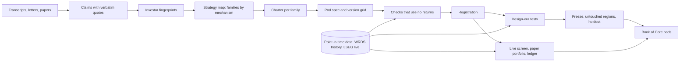

# Equity pod shop: workflow design v0.1 (draft for discussion, 2026-11-14)

Status: design only. Nothing here is built, pulled or run. It carries the method of the macro pod shop
(`docs/research/WORKFLOW.md` v2.1) over to picking individual stocks. The file is written to be handed to other
chats: it is self-contained, section 15 lists what already exists in the repo, and section 17 lists the points most
likely to change in discussion. Numbers marked "proposal" are placeholders; they are fixed at registration
(step E3.5), before any run. Drafted by Claude (Fable 5.2) in the macro-shop session; it has not yet had an
independent check (first item in section 13). Terms are explained in section 19.

## 1. What we are building

A stock-picking shop run as pods. A pod is one way of making money in stocks: one mechanism, meaning who is on the
other side of the trade and why they keep paying. Each pod has its own charter, rule spec, live screen, paper
portfolio, backtest and live record. Sources (transcripts, letters, papers) feed pods. A pod is never "an investor";
it is a mechanism that several independent investors describe.

| Goal | Product | Made in |
|---|---|---|
| 1. Company data | A point-in-time data panel with a lock and a seal | E1 |
| 2. Strategies from transcripts | A strategy map (families of investors who make money the same way) and one charter per family | E2 |
| 3. Screening in real time | One live screen per pod, refreshed weekly, run by the same code as the backtest | E6 |
| 4. Portfolio and backtest per strategy | A portfolio rule inside each spec, one fixed test sheet, a verdict by rule | E3-E5 |

Every strategy is split into three layers:
- **Rule layer**: criteria a script can compute from data as they were known on the day. Backtested.
- **Proxy layer**: measurable stand-ins for qualitative criteria (for example "pricing power" read as a stable
  gross margin). Backtested, but flagged. A stand-in needs a quote that states it, or the checker's agreement.
- **Analyst layer**: an agent's judgement on what no rule captures (moat, management, culture). It is never
  backtested, because the model already knows what happened to every company. It is judged only on its live record.

## 2. What is different from macro, and the design answer

| Topic | In stocks | Design answer |
|---|---|---|
| Breadth | Thousands of stocks; a screen holds a small subset | Test the portfolio's monthly returns through time, never single picks; compare with matched random portfolios |
| Known return sources | Value, momentum, profitability, quality, low risk and size are published and cheap to buy | Skill is measured after these factors and against simple published rules; a pod that only repackages a factor becomes a "Sleeve" |
| Data traps | Restated accounts, reporting delays, dead companies, several share lines per company, tiny illiquid stocks | Point-in-time panel, delisting returns, one line per company, an investability floor, plumbing gates before any test |
| Sources | Stock pickers speak in qualities, not rules; we hear the survivors; most talks are recent | Criteria sorted into rule, proxy and analyst layers; a say-do check on reported holdings; verdicts only from samples the sources could not have shaped |
| Judgement | Much of the claimed edge is reading a business | Forward-only analyst layer with a logged, scored record |
| Horizon | One to five years for many styles, so few independent observations | Overlapping tranches; a power check decides whether history can test a pod at all |
| Portfolio | Which names, how many, what weights | The portfolio rule is part of the spec; versions are averaged, not picked |
| Our own first result | The three triage screens showed no alpha after factors; their warnings worked (`docs/research/triage_wrds/RESULTS.md`) | Factor attribution on every pod; a separate "Exclusion" class for warning rules |

## 3. Rules of the shop

1. The pod is the unit of work, testing and risk. One mechanism per pod.
2. What an investor said is established only by a verbatim quote. A number that appears only in a summary supports
   nothing.
3. Each strategy is split into rule, proxy and analyst layers. The first two are backtested; the analyst layer is
   judged live.
4. The chain is tested link by link (section 4.1). A failed link stops the chain before a return test is spent.
5. Inside a pod every registered version is run and averaged. The list is fixed at registration; changing it later
   counts as a new trial.
6. Data are used as they were known on the day: report dates, first-reported values, the universe of that day, dead
   companies included.
7. Skill is what is left after known factors, simple published rules, matched random portfolios and costs.
8. Evidence ladder, weakest to strongest: design era -> untouched regions -> holdout 2011+ -> live record. A sample
   counts for a verdict only if the pod's sources could not have been shaped by it.
9. The testing budget is fixed in advance and every run is logged. A failed idea is not re-run with tweaks.
10. Backtest and live screen run the same code. Every input needs a live source. Where history and live data come
    from different vendors, the two must agree on overlapping dates before a pod can be Core.
11. Licensed data stay where the licence puts them (WRDS Cloud, the PC). Only whitelisted outputs come back.
12. No step grades itself. Fable judges small inputs and every Fable output gets an independent Opus check. Builders
    do not see results. Checkers are themselves tested with planted defects.
13. Open design choices are never settled by taste. Each becomes a version, a diagnostic with a gate fixed in advance,
    or is dropped with a reason. The user releases stages.

## 4. Evidence design

### 4.1 The chain, tested link by link
A stock strategy is a chain of three links.
1. **Rule -> selection.** The rule picks the kind of company the investors describe. Tests: an independent agent
   rebuilds the screen from the written spec alone; the screen is compared with what the source investors actually
   held (say-do check). No returns are used, so a spec may be corrected here, with every change logged.
2. **Selection -> business outcome.** The companies picked go on to show what the thesis claims (returns on capital
   stay high, margins recover, the spun-off unit grows faster). Tested on accounts only, no prices. One diagnostic per
   pod, declared in the charter with its gate. It cannot be tuned: business outcomes and returns move together, so
   fitting this link would fit returns by the back door.
3. **Business outcome -> price.** The market had not already paid for it. Tested once per pod on returns with the
   test sheet (section 9).

### 4.2 Samples and the seal
| Sample | Definition (proposal) | Use |
|---|---|---|
| Design era | US common stocks, 1975-01 to 2010-12 | All building, diagnostics and design tests |
| Untouched regions | Developed markets outside the US (list fixed at E1.4), 1990-01 to 2010-12 | Sealed; one run after the freeze |
| Holdout | All regions, 2011-01 to the latest data. Same seal date as the macro book | Sealed; one run after the freeze |
| Live | From the day a pod's spec is registered | Forward ledger; the only clean test of the analyst layer |

A time seal alone is not enough for stocks, for two reasons. First, we hear the investors who did well, and their
talks describe what worked for them; a backtest over their own career years confirms the description, not the edge.
Second, the models that write specs know market history to mid-2026. So the thesis register (E2.9) records for each
family the earliest published statement of the thesis (publication and year) and the years in which its source
investors built the record they cite ("career years"), and three rules follow:
- The holdout gives a verdict only for theses documented before 2011 (macro rule 5).
- A family whose sources built their record mainly after 2010 is marked "career overlap": its holdout result is
  reported, not a verdict. It is judged on untouched regions and its live record.
- A pod whose inputs only exist after 2010 (many software and AI measures) has no design era. It is an Incubator pod,
  judged live.

The three triage screens were already tested on 2008-24, so their US holdout is spent. They can be Exclusion
candidates (judged on the design era and untouched regions), Incubator or Shelved.

### 4.3 What a pod is compared with
1. Its own universe and the market.
2. A characteristic-matched benchmark: each stock against others of similar size, value and momentum.
3. A factor model: the Fama-French five factors plus momentum for its region.
4. Simple published rules, in the pod's universe, holding the same number of names: Piotroski F-score, the magic
   formula, gross profitability; plus the nearest published factor theme.
5. A placebo: 10,000 random portfolios with the same number of names from the same size and sector cells.
6. Costs: at the registered level and at double.

### 4.4 Verdict classes
- **Core**: passes the decisive tests in the design era, passes untouched regions and the holdout by the registered
  rule, thesis documented before 2011, a live source for every input, and an independent rebuild matches.
- **Sleeve**: positive after costs and above its placebo, but nothing is left after factors, or a simple rule does
  as well. Kept as a factor holding built the cheapest way. Overlapping sleeves are merged and counted once.
- **Exclusion**: a warning rule that predicts large losers. Applied as a filter on every pod's universe.
- **Incubator**: positive after costs and passes placebo and tail, but something is missing (hindsight flag, too
  little power, no live source, no design era). Runs in shadow with a live screen and ledger.
- **Shelved**: the rest. Logged; not re-run with tweaks.

Every pod gets a live screen and a paper portfolio. The class says how much weight it has earned.

## 5. Data plan

### 5.1 Sources and roles
| Source | Runs on | Role | Checked so far | Still to test |
|---|---|---|---|---|
| WRDS: CRSP, Compustat North America and Global, I/B/E/S, 13F holdings, Fama-French, Global Factor Data | WRDS Cloud through `tools/wrdsq`; only statistics come back | Reference history for every backtest; factor and baseline series; holdings for the say-do check | All are on the subscription list in `CLAUDE.md`. Global Factor Data (Jensen, Kelly, Pedersen) offers stock returns and firm characteristics ready-made | Table permissions; last dates (CRSP is updated once a year); how Compustat restatements are handled |
| LSEG Workspace and Datastream | The user's PC (Excel, or the Python desktop interface), PC job runner | Live source for every input; history WRDS lacks (sector metrics, events); second source for cross-checks | LSEG fact sheet: up to 108,000 active and inactive companies; US from 1983, other countries from 1995; as-reported and restated values; "point-in-time details on the source publication". LSEG usage guide: about 5 requests a second, 50 MB a minute, 3,000 rows per history request | What this licence returns; request and volume limits; prices carried forward after a delisting; identifiers; whether first-reported values can be pulled in bulk |
| SEC filings and Massive prices (free; `qs/`, `triage/`) | Cloud, GitHub Actions | Free live fallback for US stocks; third check | Point in time by filing date; running today | 2009 onward and US only |

Default (a rule, not a choice for the user): history on WRDS, live on LSEG. LSEG history is used where it passes the
same gates. A pod goes live only when its signals built on LSEG agree with the same signals built on WRDS for
overlapping months. From the first live week every snapshot is stored, so the shop builds its own point-in-time
archive. LSEG delivers raw fields only; the screen logic lives in our engine.

### 5.2 Point-in-time rules (fixed at E1.3)
- An accounting item is usable from its report date plus one trading day. Where the date is missing: period end
  plus four months.
- Restatements: the first-reported value where the source has it; otherwise the standard value with the lag rule.
  The size of the difference is measured where both exist.
- Universe of the day: listed common shares, primary line, one line per company, dead companies included.
- Returns include dividends and the delisting return. Vendor prices carried forward after a delisting are cut.
- Analyst estimates: the consensus as it stood on the day.
- Sector: the code of the day where history exists; otherwise today's code, flagged.
- Investability floor: fixed in Batch A (proposal: above the smallest fifth of NYSE stocks by size, with a floor on
  price and on median daily trading value).

### 5.3 Gates before any strategy is tested
| Gate | Pass when |
|---|---|
| G1 Probe | We know what each source returns under this licence, and its limits |
| G2 Market | Our value-weighted universe return matches the published market return |
| G3 Factors | Our own value, momentum and profitability factors match the published ones (proposal: correlation of at least 0.9) |
| G4 Survivorship | Firm counts by year and the share of delisted firms look right; delisting returns present |
| G5 Duplicates | No copied series, stale prices or doubled companies (lessons: the Bloomberg copy glitch, the doubled US 2-year market) |
| G6 Truncation | Cutting the data at any date leaves every earlier signal unchanged |
| G7 Two sources | WRDS-built and LSEG-built signals agree on overlapping months (proposal: rank correlation of at least 0.9 per measure, overlap of picks at least 0.8) |
| G8 Seal | Holdout years and untouched regions sit behind a one-time key; lock id recorded |

### 5.4 What may come back to the cloud
Names of screen candidates with pass or fail per criterion and rank bands; counts; coverage; date ranges; summary
statistics over at least 60 months; lock and config ids. No vendor values per company and date, and no return series.
The existing whitelist in `tools/bbgq/README.md` is extended, not replaced.

## 6. Knowledge pipeline: from transcripts to strategy charters

### 6.1 What we do not know yet, and the pilot that measures it
The research store holds 397 transcripts (about 3.5M words) with fact-checked notes, but not yet claims with
verbatim quotes. A pilot on 12 transcripts, two per style or sector, answers before anything is scaled:
1. How many distinct investors and firms are there? How many appear twice or more? How many file 13F holdings?
2. How many claims per transcript are selection criteria, and what share can a script compute?
3. Do criteria come with numbers, or only with directions?
4. Does the investor state why the opportunity exists and who is on the other side?
5. Is there a dated track record or a dated stock view?
6. Do two independent readers agree?
7. What does one transcript cost in tokens, per pass?

CEO interviews are evidence about companies, not strategy sources. They are set aside for the analyst layer.
Investor letters and books can enter through the same pipeline, tagged by source type.

### 6.2 Claim types (adapted from the macro extraction spec)
Selection criterion; avoidance criterion (red flag); valuation rule; entry trigger; exit rule; sizing and
concentration; risk control; edge claim (why it is mispriced, who is on the other side); evidence offered; named
example (company, date, outcome: kept apart, never used to set a threshold); sector measure; dated view (goes to the
forecast ledger). Each claim carries its quote, the exact rule if stated, the data it needs, the horizon, and whether
a script can compute it (yes, partly, no).

### 6.3 The investor fingerprint (fixed codebook, one card per investor)
| Field | Categories |
|---|---|
| Universe | Region; size range; sectors |
| Return engine (up to two) | Earnings growth; re-rating; cash yield; asset value realised; event completion; cycle turn |
| Edge claim | Behavioural (others overreact or extrapolate); structural (forced sellers, index rules, neglect); informational (primary research, sector expertise); analytical; risk bearing; longer horizon |
| Quality demands | Returns on capital; margins; balance sheet; durability of growth; management and ownership |
| Valuation anchor | Multiple of earnings or cash flow; required return; asset value; own history; none |
| Entry trigger | Valuation level; price drop; event; turn in the business; relative strength; none |
| Holding period | Under 3 months; 3-12 months; 1-3 years; over 3 years |
| Concentration | Number of positions; weight of the top ten |
| Sell rule | Thesis broken; price target; time stop; stop loss; better idea |
| Risk controls | Position caps; sector caps; leverage; hedges; shorting |
| Evidence offered | Audited record; examples; none |

Sonnet codes every card with claim ids; Opus recodes a fifth blind. A field with low agreement is dropped from the
clustering (the macro forecast ledger dropped "confidence" at 55% agreement for the same reason).

### 6.4 From fingerprints to families
- A script clusters the cards on the agreed fields. Fable then names the families by mechanism (return engine, edge
  claim, other side), merges and splits with reasons, and lists the orphans. Opus checks every defining statement
  against the quotes.
- A family needs at least three independent investors (different firms), or two plus a published source
  (proposal). Smaller groups become single-investor playbook cards (Incubator).
- Styles that did badly in recent years stay in. Dropping them would select on the outcome.
- No agent in this chain sees any return data.
- Prior guesses, to be confirmed or replaced, not assumed: quality at a fair price; deep value and mean reversion;
  growth at a turning point; special situations; owner-operators and insiders; sector specialists (banks, biotech,
  technology); short theses (candidates for the Exclusion class).

### 6.5 The strategy charter (one per family; Fable writes, Opus checks against the quotes)
The mechanism as a chain and the other side; the criteria table (criterion, claim ids, number of independent
investors, layer, data field, threshold as stated); where investors disagree; the one business-outcome diagnostic with
its gate; when the strategy should stop working; the known factors it probably loads on; documentation date and
career years; pack problems; a self-check.

## 7. From charter to pod

### 7.1 Spec (one page, fixed form)
Economic claim; what is predicted (proposal: return against the matched benchmark over 12 months); universe and
eligibility; each signal with its formula and field ids; each threshold with where it comes from (a quote id, a market
convention, or the grid); how criteria combine; selection rule; portfolio rule (section 8); benchmark; costs; version
grid; the sample (fixed here, not by the builder); what would prove it wrong; when it should stop working; knobs that
were tuned; live source and delay for every input.

Hindsight guards: no ticker, company name, year or event may appear in a rule. The sign of a signal cannot be flipped
after results. Every threshold must trace to a quote, a convention or the grid, and a script checks the ids.

### 7.2 Version grid (each dimension needs a stated reason for model uncertainty; proposal: at most 16 versions)
- Threshold type: the level as stated; a percentile of the universe; a percentile of the company's own history.
- Combination: every gate must pass; or a score.
- Measure definition, where sources differ (for example return on invested capital against return on equity).
- Lookback (for example five or ten years of history).
- Names held (for example 20 or 40) and weighting (equal, or by inverse volatility).
- Start months run as tranches, so no single rebalance date decides the result.

### 7.3 Checks that use no returns
| Check | Pass when (proposals from `validation/PROTOCOL.md`) |
|---|---|
| Re-implementation | An agent that never saw the code rebuilds the screen from the spec; overlap of pass lists at least 0.9 |
| Say-do | The source investors' reported holdings pass the screen at three times the universe rate or more. For quarters after 2010 only accounting measures are used: no prices, no returns |
| Business outcome | The charter's one diagnostic passes its gate |
| Coverage | At least 5 names in more than half of the months; otherwise "too little history" |

### 7.4 Power check
A script runs random portfolios with the pod's size and universe, with a known true alpha added (proposal: 0, 2 and
4 percent a year), through the test sheet. A pod that would rarely pass even with real skill is not tested on
history. It becomes an Incubator pod, so no slot is spent on a test that cannot succeed.

### 7.5 Which families get a test slot
At most eight pods get a design test (two batches of four). A script ranks the families by number of independent
investors, share of criteria in the rule layer, power, and distance from families already chosen. The rest are
Incubator pods.

## 8. Portfolio construction (part of every spec)
- The holding period comes from what the sources say, not from optimisation. Each formation month starts a tranche
  held for that period; the pod's return is the average of its live tranches.
- Weights: equal, or by inverse volatility, as versions. No conviction weights unless a rule supplies them.
- Limits (proposals): a cap per name; sector weights within a band of the benchmark; a minimum number of names; a
  liquidity floor per position.
- Sell rules come from the sources (thesis broken as measured by the rule, valuation target, time stop).
- Each pod is reported two ways: on its own (return, risk, worst fall) and against its matched benchmark (active
  return, active risk, worst active fall). No timing overlay unless it is itself a registered, tested rule.
- The book: Core pods at equal active risk, with a cap on any one known factor so that five pods do not add up to one
  quality bet. The merged Sleeve counts once. No switching between pods.
- Long only, with an index hedge as a reporting view. Short theses are tested as loser prediction (Exclusion), since
  borrow costs are not in the data.

## 9. Test sheet, verdict, budget, holdout
Design tests are monthly, on US stocks 1975-2010, with every input at its live delay.

Decisive, all four:
1. **Alpha after factors.** The pod's net monthly return (average of all versions and tranches) over Treasury bills,
   regressed on the five factors plus momentum of its region; Newey-West errors; one-sided; corrected for the number
   of pods in the batch (Holm). The return against the characteristic-matched benchmark must have the same sign.
2. **Survives double costs.** The alpha of test 1 stays positive at twice the registered costs.
3. **Beats its placebo.** The pod's return against its matched benchmark lies above the 95th percentile of the
   same measure for the 10,000 matched random portfolios.
4. **Tail.** The worst fall against its matched benchmark stays inside the registered bound, and the pod's own worst
   fall is not materially deeper than the benchmark's.

Sleeve rule: a pod that fails test 1 or 2 but still beats its own universe after costs and passes tests 3 and 4 is
a Sleeve. So is a pod that a pre-named simple rule beats with a difference t of 2 or more.

Reported, not decisive: three eras (1975-89, 1990-99, 2000-10); by size group and sector; share of versions positive;
a one-month trading delay; deflated Sharpe from the trial log; a t of 3 as a reference line; cost sensitivity;
turnover; capacity as a share of daily trading; fragility (result with any one year or sector removed); factor
loadings; hit rate by signal strength.

Budget:
- **Batch 0** (no slots): plumbing. The simple published rules run through the engine and must look as published.
- **Batch A**: hygiene, tested on the baseline portfolios only, so pods cannot influence it: data swap WRDS against
  LSEG, investability floor and cost model, tranche scheme, the Exclusion overlay. Test: does not hurt; for the
  overlay, cuts large losses.
- **Batches B1 and B2**: at most four pods each. Each batch may wrongly adopt a useless pod with at most 2.5%
  probability. Rule layers of single-investor playbooks run in B2 for Incubator status only.
- **Freeze**, then one run on untouched regions and one on the holdout, criteria registered beforehand (proposal:
  every Core pod keeps a positive alpha after factors and costs in both; the book earns at least 0.3 units of active
  return per unit of active risk, net, with a worst active fall above -20%).
- No redesign from holdout data either way. After the holdout every new pod enters as Incubator and is promoted only
  on its live record.

## 10. Live cycle (paper)
| Step | What | Who |
|---|---|---|
| W1 | Weekly refresh of the universe fields from LSEG on the PC; checks; snapshot archived | PC runner; Sonnet triages alerts |
| W2 | Every pod's screen: candidates with pass or fail per criterion, near misses, exclusions, data flags; target portfolio and changes; for each candidate the design-era hit rate of its score band | script |
| W3 | Shadow: Incubator pods; analyst memos on each new candidate (fixed rubric from the charter's analyst-layer criteria; a probability of beating the matched benchmark over 12 months; model id logged, a model change starts a new record) | script; Opus analysts |
| W4 | Ledger: candidates, portfolios and forecasts appended before the week starts | script; append-only branch |
| W5 | Scoring and health: resolved forecasts; signals arrive; live against backtest bands; stale or missing inputs; each pod's own stop conditions | script |
| W6 | One-page weekly report, fixed template | Sonnet |
| M | Monthly: tranche rebalance; Fable reads the ledger and scorecards | script; Fable |
| Q | Quarterly review; promotions only at registered checkpoints with stated sample sizes | Fable; Opus checks |

A pod's live clock starts when its spec is registered, before its backtest result is known, because live evidence
only accrues with calendar time. Analyst grades never touch a portfolio before a registered live checkpoint.

## 11. Who does what
| Tier | Role | Steps |
|---|---|---|
| Fable 5.2, effort max, one unit a day | Strategist: strategy map, one charter per family, playbook cards, batch reviews, holdout verdict, monthly review | E2.6-2.8, E4.6, E5.4, M, Q |
| Opus 5.5, effort high | Quant and risk officer: data, engine, field dictionary, specs, independent checks, re-implementation, rebuilds, weekly analysts | E1, E2.5, E2.9, E3, E4, E5, W3 |
| Sonnet 5.5, effort high | Research assistant and operations: inventory, extraction, coding, packs, weekly report | E0.1, E2.1-2.4, W1, W6 |
| Scripts, WRDS runner, PC runner, GitHub Actions | Everything mechanical: quote checks, clustering, data gates, backtests, verdicts, ledgers | throughout |

Controls carried over from the macro program: a private work folder per agent; the exact input of every Fable run
stored; quotes checked by script; the builder of a pod does not see earlier results; corrections delivered as exact
find-and-replace pairs; token use estimated before and logged after each step.

## 12. Steps
| # | Step | Agent | Gate / output |
|---|---|---|---|
| **E0** | **Scope and inventory** | | |
| E0.1 | Transcript inventory from the existing notes: speaker, role, firm, date, style tags, 13F filer or not, priority tier | Sonnet; script | table; counts by style |
| E0.2 | Audit of what exists: criteria workbook, archived screens, triage rules and results, validation protocol; marked unverified until tied to quotes | Opus | one page |
| E0.3 | Equity paper pack (12-20 papers on testing method, factors, costs, investor skill) through the paper pipeline | Sonnet; Opus blind read | claims with quotes |
| **E1** | **Data foundation** | | |
| E1.1 | LSEG equity probe: universe with inactive companies, identifiers, report dates, first-reported values, estimates history, ownership and insiders, events, sector measures, limits | Opus builds; user pulls once | probe report (G1) |
| E1.2 | WRDS table check | Opus; WRDS runner | report |
| E1.3 | Field dictionary: every criterion's inputs defined once per source, with its lag rule | Opus | dictionary |
| E1.4 | Reader with as-of access; seal of 2011+ and of the untouched regions; lock id | Opus; script | G8 |
| E1.5 | Plumbing gates | script; Opus triage | G2-G6 |
| E1.6 | Two-source reconciliation | script | G7 |
| **E2** | **Thesis library** | | |
| E2.1 | Pilot on 12 transcripts | Sonnet; Opus blind read | answers to section 6.1 |
| E2.2 | Claims with verbatim quotes, tier A first; script quote check; blind second read of a sample | Sonnet extracts; Opus second read | claim ledger; agreement rate |
| E2.3 | Process map per speaker (idea source, criteria, valuation, entry, sizing, exit, edge, evidence) | Sonnet | maps |
| E2.4 | Fingerprint cards; a fifth recoded blind | Sonnet; Opus | cards; agreement table |
| E2.5 | Say-do profile of investors with reported holdings (no returns) | Opus; WRDS runner | profiles |
| E2.6 | Strategy map | script clusters; Fable judges; Opus checks | families, members, orphans |
| E2.7 | Charter per family | Fable; Opus check | charters |
| E2.8 | Playbook cards for single investors | Sonnet packs; Fable | cards |
| E2.9 | Thesis register: family, pod, rule sketch, data, evidence grade, documentation date, career years | Opus; script checks ids | one table |
| E2.10 | Dated stock views into the forecast ledger (descriptive) | Sonnet; script | scorecard |
| **E3** | **Specs and registration** | | |
| E3.1 | Pod spec | Opus | spec |
| E3.2 | Spec check and blind re-implementation | fresh Opus agent | approved spec |
| E3.3 | Say-do, business-outcome and coverage checks | script | a say-do miss goes back to E3.1, logged; a failed business-outcome gate ends the pod's history test |
| E3.4 | Power check; slot ranking | script | pass-rate table; batch lists |
| E3.5 | Registration: batches, pods, grids, tests, error budget, freeze rule, holdout consequences, live checkpoints, committed before any run | Opus | one-page summary to the user |
| E3.6 | Checker test with planted defects (restated data, dropped dead companies, shifted sample, missing costs, doubled share lines) and clean controls | Opus plants; fresh Opus checks | catch rate on record |
| **E4** | **Design-era tests (WRDS Cloud, to 2010)** | | |
| E4.1 | Batch 0: published rules through the engine | Opus | report |
| E4.2 | Batch A: hygiene | Opus | report |
| E4.3 | Batches B1 and B2 | Opus builds; Sonnet may run the standard sheet | result sheets |
| E4.4 | Verdict by rule | script | verdict |
| E4.5 | Independent rebuild of each Core pod from its spec; match within 15% | fresh Opus agent | match report |
| E4.6 | Batch review from the result tables only; every statement quotes its number | Fable; Opus checks | review note |
| **E5** | **Book, freeze, holdouts** | | |
| E5.1 | Book config | Opus | config |
| E5.2 | Freeze: config id and lock id | Opus | record |
| E5.3 | One run on untouched regions, one on the holdout | script | reports |
| E5.4 | Verdict | Fable; Opus checks the numbers | verdict note |
| E5.5 | Execution spec, only before real money | Opus | spec |
| **E6** | **Live cycle** (section 10) | | |
| **E7** | **Always on**: research log with ids, code version and lock id; exact inputs stored; Obsidian as the single store; usage log | script; Sonnet | |

## 13. Order of work and stage gates
0. Independent Opus review of this draft, as was done for the macro workflow; its findings folded into v0.2.
1. **Stage 1: find out what is possible** (cheap). E0.1-E0.2, E1.1-E1.2, the pilot E2.1, and Batch 0 on WRDS. Output:
   one page with the number of investors and styles, the share of criteria a script can compute, the cost per
   transcript, what LSEG returns, and whether our engine reproduces the published factors.
2. **Stage 2: build the library.** E2.2-E2.10 alongside E1.3-E1.6.
3. **Stage 3: specs, registration, design tests.** E3, then E4 batch by batch. Live screens start at E3.5.
4. **Stage 4: freeze, untouched regions, holdout, book.** E5.

Effort, from what the macro program measured: one Fable unit costs about 0.65-0.9M tokens and its Opus check about
0.3M. This design needs roughly 10-16 Fable units (one map, 6-12 charters, two batch reviews, one verdict). The cost
of extraction is measured in the pilot before it is scaled.

## 14. What can go wrong, and the answer built in
| Risk | Answer |
|---|---|
| Every strategy turns out to be a known factor | The Sleeve class makes that a usable result: a cheap factor holding plus exclusions, with the analyst layer judged live |
| Transcripts are too vague to give rules | The pilot measures it first; vague families become playbook cards with an analyst layer |
| LSEG history is not point in time, or lacks dead companies | History stays on WRDS; our own archive starts with the first live week |
| Too little power for concentrated, long-horizon pods | Power check before any slot is spent; such pods are judged live |
| Hindsight through the models' knowledge | Thresholds must trace to quotes; builders are blind to results; verdicts come from untouched regions, the holdout and the live record |
| We only hear investors who did well | Career years recorded; holdout verdict only for theses documented before 2011; losing styles kept in the map |
| University licences end | Free US fallback (SEC and Massive) kept working; archive kept |
| Token cost grows | Pilot first; tiers; one Fable unit a day; Sonnet for bulk work |
| Vendor limits (the Bloomberg allowance problem) | Limits read in the probe; pulls sized and resumable |
| Backtest and live screen drift apart | One code path; fingerprints of rules and behaviour, as in `validation/freeze.json` |

## 15. What exists already (reuse)
- `docs/research/WORKFLOW.md`: the macro pod shop this design copies.
- `validation/PROTOCOL.md` (2026-10-20): equity statistics already written: point-in-time rules, matched benchmark,
  baselines, placebo, alpha test, re-implementation, style fidelity. Never run on a long history.
- `docs/research/triage_wrds/RESULTS.md` (2026-10-31): the first WRDS test of the three triage screens.
- `triage/`, `qs/`: live US screens on free data; point-in-time SEC code.
- `tools/wrdsq`: WRDS job runner and the CRSP / Compustat adapter. `tools/bbgq`: PC job runner, reader with as-of
  access, lock and seal, export whitelist.
- `tools/fcast`: forecast ledger and scorer.
- Branch `research`: 397 transcripts with notes (`index.jsonl`, `scripts/search.py`).
- Branch `macro-vault`: extraction, cross-check, map and synthesis specs; brief templates; `build_note.py`.
- `docs/criteria/Screener_Criteria.xlsx`: 157 criteria with rationale. Useful input, unverified until tied to quotes.
- Known weak spot: an earlier re-implementation of one screen from its written rules reached an overlap of only 0.58,
  because the rules were underspecified. Hence E3.2.

## 16. Needed from the user (facts, not design choices)
1. A go per stage.
2. One pull of the LSEG probe file (E1.1), and whether the licence covers the Workspace Python interface. Any key
   for it stays in a file on the PC, never in chat or the repo.
3. PDFs for the equity paper pack (list comes with E0.3).
4. How long WRDS and LSEG access will last.
5. Which markets the paper portfolios should hold (default: US; other regions are used for testing only).
Only before real money: account size and broker.

## 17. Points most likely to change in discussion
- The seal date. 2011 keeps one seal across the shop but gives up modern-era data for design.
- The history source, once the LSEG probe is in.
- The number of test slots (eight), once the strategy map shows how many families exist.
- The list of untouched regions.
- Whether sector pods (banks, biotech, technology) can have a rule layer at all; it depends on point-in-time sector
  data.
- The predicted horizon (12 months).

## 18. References
Checked on the web on 2026-11-14:
- LSEG, "The Data Library for Python: maximum usage reference guide" (request and volume limits).
- LSEG Company Fundamentals fact sheet (coverage, history, as-reported and restated values).
- Kelly lab, `ReplicationCrisis` and `jkp-data` repositories (stock returns and firm characteristics on WRDS Global
  Factor Data).

From the designer's knowledge, to be verified when each paper enters the store: Fama and French (2015) five factors;
Carhart (1997) momentum; Daniel, Grinblatt, Titman and Wermers (1997) matched benchmarks; Jegadeesh and Titman (1993)
overlapping portfolios; Harvey, Liu and Zhu (2016) on multiple testing; McLean and Pontiff (2016) on decay after
publication; Hou, Xue and Zhang (2020) and Jensen, Kelly and Pedersen (2023) on replication; Novy-Marx (2013) gross
profitability; Novy-Marx and Velikov (2016) trading costs; Asness, Frazzini and Pedersen (2019) quality; Frazzini,
Kabiller and Pedersen (2018) on Buffett's returns; Piotroski (2000); Greenblatt (2005); Bailey and Lopez de Prado
(2014) deflated Sharpe ratio; Shumway (1997) delisting bias; Ince and Porter (2006) on Datastream equity data; Chan,
Karceski and Lakonishok (2003) on the persistence of growth; Fama (1998) on long-horizon event tests; Glasserman and
Lin (2023) and Sarkar and Vafa (2024) on look-ahead in language models.

## 19. Terms
- **Alpha**: the part of a portfolio's return that its exposure to known factors does not explain.
- **Factor**: a published, cheap-to-buy return source such as value, momentum or profitability.
- **Point in time**: using only what was published by the day in question.
- **Matched benchmark**: for each stock, the average return of stocks of similar size, value and momentum.
- **Placebo**: random portfolios with the same number of names from the same size and sector groups.
- **Version grid**: the fixed list of reasonable variants of one rule; all are run and averaged.
- **Tranche**: one of several copies of a portfolio started in different months, so the start date does not matter.
- **Holm correction**: a way to keep the chance of any false pass in a batch at the stated level when several pods
  are tested together.
- **Seal, holdout**: data locked away until the rules are frozen, then looked at once.
- **Say-do check**: comparing what an investor says they buy with what their reported holdings show.
