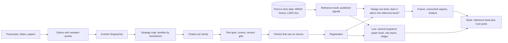

# Equity pod shop: workflow design v0.2 (long/short; draft for discussion, 2026-11-15)

Status: design only. Nothing here is built, pulled or run. It carries the method of the macro pod shop
(`docs/research/WORKFLOW.md` v2.1) over to stocks. v0.2 replaces v0.1 (2026-11-14), which designed a long-only
shop; the goal is a long/short book, slow, statistical, with every piece of logic checked against data. Section 2 is
the critique of v0.1 that drove the changes. It is a self-review by the author (Claude, Fable 5.2), written from the
seat of an experienced long/short investor; an independent check is still due (section 14, item 0).

The file is written to be handed to other chats: it is self-contained, section 16 lists what already exists in the
repo, section 18 the points most likely to change, section 20 the terms. Numbers marked "proposal" are placeholders;
they are fixed at registration (step E3.5), before any run. Biotech has its own design:
`BIOTECH_DESK_DESIGN_v0.1.md`.

## 1. What we are building

A long/short stock shop run as pods. A pod is one way of making money in stocks: one mechanism, meaning who is on the
other side of the trade and why they keep paying. Each pod has a charter, a rule spec, a live screen, a paper
portfolio, a backtest and a live record. Sources (transcripts, letters, papers) feed pods.

The book is market-neutral: equal money long and short, no net exposure to the market or to any sector. What is left
is the return from choosing stocks. It is slow by design: signals move monthly, holdings last months to years, and
nothing uses prices within the day.

The book has four parts:
1. **Reference book.** A plain long/short portfolio built from a handful of published signals that have a stated
   mechanism (value, momentum, quality, expectations). It is the benchmark every other idea must beat, the first
   thing to run live, and the test that our engine works.
2. **Investor pods.** Strategy families found in the stock-picker transcripts. A pod joins the book only for what it
   adds on top of the reference book.
3. **Short and avoid rules.** Warning signs that predict large losers. Used as short candidates where the stock can
   be borrowed cheaply, and as exclusions from the long side everywhere else.
4. **Analyst layer.** An agent's judgement on what no rule captures. Never backtested; judged on a live forecasting
   record that resolves every quarter.

Every strategy is split into three layers:
- **Rule layer**: criteria a script can compute from data as they were known on the day. Backtested.
- **Proxy layer**: measurable stand-ins for qualitative criteria (for example "pricing power" read as a stable
  gross margin). Backtested, but flagged. A stand-in needs a quote that states it, or the checker's agreement.
- **Analyst layer**: judgement (moat, management, culture). Forward only, because the model already knows what
  happened to every company.

## 2. Critique of v0.1, and what v0.2 changes

| # | Weakness in v0.1 | Why it matters for risk-managed alpha | Change in v0.2 |
|---|---|---|---|
| 1 | Long only; shorts reduced to an exclusion list | The goal is long/short. A long-only book mostly earns the market; the stock-picking part is small and hidden | A market-neutral, sector-neutral book; a designed short side (section 9) |
| 2 | Risk was a list of caps | In long/short, unintended bets (market, sector, style, crowding) are the usual cause of large losses, not bad picks | A written risk charter, a simple transparent risk model, a weekly risk report (9.3-9.4) |
| 3 | Skill was measured against academic factors on paper | Academic factors ignore our costs, our universe and borrowing. Beating them on paper is not the same as adding to a real book | Every pod must add to a reference book run under our own costs and limits (section 5) |
| 4 | Screens were pass-or-fail gates | Gates throw away information and make names flip in and out at the threshold, which raises turnover | Continuous scores ranked inside each sector; gates only for eligibility and exclusions (9.2) |
| 5 | The chain stopped at "the business does well" | Prices move when results differ from what was expected, not when results are good | An expectations link (analyst estimates, price-implied growth) and a base-rate library (4.1, 8.4) |
| 6 | No borrow cost, financing, or squeeze control | Published short-side returns are largest where shorting is hardest; a squeeze can undo years of gains | A shortable set, a fee schedule tested at double, limits on crowded shorts, each side reported on its own (9.1, 9.4, 9.5) |
| 7 | Design era pooled 1975-2010 | Much of what worked before 2001 lived in small, illiquid stocks and an older market | A liquid universe; the result must not fail in 2001-10; backtest results halved for planning (9.1, 10) |
| 8 | A family needed three investors, nothing more | What every famous investor says is the most likely to be priced in and crowded | Each family must state why the opportunity is still there; crowding is measured and capped (7.3, 9.6) |
| 9 | The analyst layer was scored on 12-month stock returns | Far too few resolved forecasts to ever earn weight | Forecasts on quarterly results against consensus, scenario values and kill criteria; hundreds resolve a year (11.2) |
| 10 | The whole library was built before anything ran | Live evidence only accrues with calendar time; months would pass with no record | The reference book goes live in Stage 1; pods join one at a time (section 14) |
| 11 | No learning loop | Without attribution nobody knows whether returns came from picks, sizing, sectors or luck | Monthly attribution: side, pod, sector, factor against stock-specific, hit rate, size of wins and losses (11.3) |
| 12 | Equal weights and caps | Weights should reflect signal strength and risk, and the same name can sit in several pods | A fixed construction rule with neutralising, a no-trade band and netting across pods (9.2, 9.6) |
| 13 | One flat cost | Long/short pays trading costs, borrow fees, dividends on shorts and financing | All four modelled; double-cost test covers trading and borrow (9.5) |
| 14 | Generic measures for every sector | Earnings and book value mean little for banks, insurers, property and biotech | Scores are sector-relative; those sectors stay out of generic pods until a sector charter defines their measures; biotech has its own desk |

What v0.1 got right and v0.2 keeps: quotes as ground truth, three layers, link-by-link testing, versions averaged,
the seal, a fixed budget, one code path for backtest and live, and the honest expectation that most investor
strategies will turn out to be known factors.

## 3. Rules of the shop

1. The pod is the unit of work, testing and risk. One mechanism per pod.
2. What an investor said is established only by a verbatim quote. A number that appears only in a summary supports
   nothing.
3. Each strategy is split into rule, proxy and analyst layers. The first two are backtested; the analyst layer is
   judged live.
4. The chain is tested link by link (section 4.1). A failed link stops the chain before a return test is spent.
5. Inside a pod every registered version is run and averaged. The list is fixed at registration.
6. Data are used as they were known on the day: report dates, first-reported values, the universe of that day, dead
   companies included.
7. The book is neutral to the market and to sectors at all times. Risk limits are written before any run and are
   not relaxed after a loss or a gain.
8. A pod earns a place only for what it adds to the reference book, after trading costs, borrow fees and financing,
   on stocks that could really have been shorted.
9. Slow by design. Signals move monthly; a holding is expected to last at least three months (proposal); turnover
   per side is capped (proposal: 100% a year). No intraday data anywhere.
10. Evidence ladder, weakest to strongest: design era -> untouched regions -> holdout 2011+ -> live record. A sample
    counts for a verdict only if the pod's sources could not have been shaped by it.
11. The testing budget is fixed in advance and every run is logged. A failed idea is not re-run with tweaks.
12. Backtest and live screen run the same code. Every input needs a live source. Where history and live data come
    from different vendors, the two must agree on overlapping dates before a pod can be Core.
13. Licensed data stay where the licence puts them (WRDS Cloud, the PC). Only whitelisted outputs come back.
14. No step grades itself. Fable judges small inputs and every Fable output gets an independent Opus check. Builders
    do not see results. Checkers are themselves tested with planted defects.
15. Open design choices are never settled by taste. Each becomes a version, a diagnostic with a gate fixed in advance,
    or is dropped with a reason. The user releases stages.

## 4. Evidence design

### 4.1 The chain, tested link by link
1. **Rule -> selection.** The rule picks the kind of company the investors describe, on both sides. Tests: an
   independent agent rebuilds the scores from the written spec alone; the long list is compared with what the source
   investors held (say-do check). No returns are used, so a spec may be corrected here, with every change logged.
2. **Selection -> business outcome.** The companies ranked high go on to show what the thesis claims (returns on
   capital stay high, margins recover); those ranked low show the opposite. Accounts only, no prices.
3. **Business outcome -> surprise.** The outcome was better (or worse) than what was expected at the time: analyst
   forecasts were too low for the longs and too high for the shorts, or the growth implied by the price was beaten.
   Estimates and accounts only, no returns.
4. **Surprise -> price.** The stock was paid for it, after costs. Tested once per pod with the test sheet
   (section 10).

Links 2 and 3 are one diagnostic each, declared in the charter with its gate. They cannot be tuned: business
outcomes, surprises and returns move together, so fitting those links would fit returns by the back door.

### 4.2 Samples and the seal
| Sample | Definition (proposal) | Use |
|---|---|---|
| Design era | US stocks in the liquid universe (9.1), 1975-01 to 2010-12, in three eras: 1975-89, 1990-2000, 2001-10 | All building, diagnostics and design tests |
| Untouched regions | Developed markets outside the US (list fixed at E1.4), 1990-01 to 2010-12 | Sealed; one run after the freeze |
| Holdout | All regions, 2011-01 to the latest data. Same seal date as the macro book | Sealed; one run after the freeze |
| Live | The reference book from Stage 1; each pod from the day its spec is registered | Forward ledger; the only clean test of the analyst layer |

A time seal alone is not enough for stocks. We hear the investors who did well, and their talks describe what worked
for them; and the models that write specs know market history to mid-2026. So the thesis register (E2.9) records for
each family the earliest published statement of the thesis and the years in which its source investors built the
record they cite ("career years"), and three rules follow:
- The holdout gives a verdict only for theses documented before 2011 (macro rule 5).
- A family whose sources built their record mainly after 2010 is marked "career overlap": its holdout result is
  reported, not a verdict. It is judged on untouched regions and its live record.
- A pod whose inputs only exist after 2010 (many software and AI measures) has no design era. It is an Incubator pod,
  judged live.

The three triage screens were already tested on 2008-24, so their US holdout is spent. They can be Exclusion
candidates (judged on the design era and untouched regions), Incubator or Shelved.

### 4.3 What a pod is compared with
1. The reference book, run with the same universe, costs and limits (section 5).
2. The Fama-French five factors plus momentum for its region.
3. A placebo: 10,000 random long/short portfolios with the same number of names per sector and side.
4. Costs: trading costs and borrow fees at the registered level and at double.

### 4.4 Verdict classes
- **Core**: passes the decisive tests in the design era, passes untouched regions and the holdout by the registered
  rule, thesis documented before 2011, a live source for every input, and an independent rebuild matches.
- **Sleeve**: works on its own after costs and beats its placebo, but adds nothing to the reference book. It is
  already in the book through the reference signals, so it is not added again.
- **Exclusion**: a warning rule that predicts large losers but cannot be shorted at a profit (borrow, squeeze risk).
  Applied as a filter on the long side of every pod.
- **Incubator**: positive after costs and passes placebo and tail, but something is missing (hindsight flag, too
  little power, no live source, no design era). Runs in shadow with a live screen and ledger.
- **Shelved**: the rest. Logged; not re-run with tweaks.

## 5. The reference book

**What it is.** A market- and sector-neutral long/short portfolio built from published signals that each have a
stated mechanism and a live source. Proposal, final list from the paper pack at E3.5: four groups, each the average
of two or three measures ranked inside the sector.
- Value: earnings, cash flow and book value against price.
- Momentum: the return of the past year, skipping the last month, held in slow tranches.
- Quality: profitability, low accruals, low asset growth, low net share issuance.
- Expectations: analyst estimate revisions and the drift after earnings surprises.
The book's score is the plain average of the four groups. No weights are fitted.

**What it is for.**
1. The benchmark. An investor pod is tested for what it adds to this book, not for looking good alone.
2. The plumbing test. In Batch 0 each signal must look as published before anything else is trusted.
3. The first live record. It runs on paper from Stage 1, with the full risk report, while the library is built.
4. The honest null. If the investor pods add nothing, this is the portfolio to hold.

**It is tested too.** In Batch A a signal group that is negative after costs in the liquid universe, or fails its
own era test in 2001-10, is dropped from the reference book before any pod is tested. A group published after 2010
(gross profitability, 2013) is flagged: it can sit in the book, but the holdout gives no verdict on it. If the
reference book fails the holdout, the shop says so plainly and nothing is Core.

## 6. Data plan

### 6.1 Sources and roles
| Source | Runs on | Role | Checked so far | Still to test |
|---|---|---|---|---|
| WRDS: CRSP, Compustat North America and Global, I/B/E/S, 13F holdings, short interest, Fama-French, Global Factor Data | WRDS Cloud through `tools/wrdsq`; only statistics come back | Reference history for every backtest; estimates for the expectations link; ownership and short interest for the shortable set; holdings for the say-do check | The subscription list in `CLAUDE.md`. Global Factor Data (Jensen, Kelly, Pedersen) offers stock returns and firm characteristics ready-made. A library guide gives Compustat short interest monthly back to 1973 | Table permissions; last dates (CRSP is updated once a year); how Compustat restatements are handled; short-interest coverage |
| LSEG Workspace and Datastream | The user's PC (Excel, or the Python desktop interface), PC job runner | Live source for every input; history WRDS lacks (sector metrics, events); second source for cross-checks | LSEG fact sheet: up to 108,000 active and inactive companies; US from 1983, other countries from 1995; as-reported and restated values; "point-in-time details on the source publication". LSEG usage guide: about 5 requests a second, 50 MB a minute, 3,000 rows per history request | What this licence returns; limits; prices carried forward after a delisting; identifiers; first-reported values in bulk; short interest and ownership fields |
| SEC filings and Massive prices (free; `qs/`, `triage/`) | Cloud, GitHub Actions | Free live fallback for US stocks; third check; public inputs for the analyst layer | Point in time by filing date; running today | 2009 onward and US only |

Borrow fees are in none of these. The design does not pretend otherwise: shorts are limited to stocks that are
almost always cheap to borrow (9.1), charged a flat fee, and tested at double the fee. At the execution stage the
broker's borrow list replaces the screen.

Default (a rule, not a choice for the user): history on WRDS, live on LSEG. A pod goes live only when its scores
built on LSEG agree with the same scores built on WRDS for overlapping months. From the first live week every
snapshot is stored, so the shop builds its own point-in-time archive. LSEG delivers raw fields only; the logic lives
in our engine.

### 6.2 Point-in-time rules (fixed at E1.3)
- An accounting item is usable from its report date plus one trading day. Where the date is missing: period end
  plus four months.
- Restatements: the first-reported value where the source has it; otherwise the standard value with the lag rule.
- Universe of the day: listed common shares, primary line, one line per company, dead companies included.
- Returns include dividends and the delisting return. Vendor prices carried forward after a delisting are cut.
- Analyst estimates: the consensus as it stood on the day. Holdings: usable 45 days after the quarter ends.
- Sector: the code of the day where history exists; otherwise today's code, flagged.

### 6.3 Gates before any strategy is tested
| Gate | Pass when |
|---|---|
| G1 Probe | We know what each source returns under this licence, and its limits |
| G2 Market | Our value-weighted universe return matches the published market return |
| G3 Factors | Our own value, momentum and profitability factors match the published ones (proposal: correlation of at least 0.9) |
| G4 Survivorship | Firm counts by year and the share of delisted firms look right; delisting returns present |
| G5 Duplicates | No copied series, stale prices or doubled companies (lessons: the Bloomberg copy glitch, the doubled US 2-year market) |
| G6 Truncation | Cutting the data at any date leaves every earlier score unchanged |
| G7 Two sources | WRDS-built and LSEG-built scores agree on overlapping months (proposal: rank correlation of at least 0.9 per measure) |
| G8 Seal | Holdout years and untouched regions sit behind a one-time key; lock id recorded |
| G9 Risk model | Forecast risk of test portfolios matches what was realised (proposal: ratio between 0.8 and 1.25) |

### 6.4 What may come back to the cloud
Names of candidates with rank bands and pass or fail per criterion; exposures and limits of the book; counts;
coverage; summary statistics over at least 60 months; lock and config ids. No vendor values per company and date, and
no return series. The existing whitelist in `tools/bbgq/README.md` is extended, not replaced.

## 7. Knowledge pipeline: from transcripts to strategy charters

### 7.1 What we do not know yet, and the pilot that measures it
The research store holds 397 transcripts (about 3.5M words) with fact-checked notes, but not yet claims with
verbatim quotes. A pilot on 12 transcripts, two per style or sector, answers before anything is scaled:
1. How many distinct investors and firms are there? How many appear twice or more? How many file 13F holdings?
2. How many claims per transcript are selection criteria, and what share can a script compute?
3. Do criteria come with numbers, or only with directions? Do investors describe shorts at all?
4. Does the investor state why the opportunity exists, who is on the other side, and why it has not been competed
   away?
5. Is there a dated track record or a dated stock view?
6. Do two independent readers agree?
7. What does one transcript cost in tokens, per pass?

CEO interviews are evidence about companies, not strategy sources. They are set aside for the analyst layer.
Investor letters, books and short-seller reports can enter through the same pipeline, tagged by source type.

### 7.2 Claim types
Selection criterion (long or short); avoidance criterion (red flag); valuation rule; what the market expects and why
it is wrong; entry trigger or catalyst; exit rule; sizing and concentration; risk control; edge claim (why it is
mispriced, who is on the other side, why it persists); evidence offered; named example (company, date, outcome: kept
apart, never used to set a threshold); sector measure; dated view (goes to the forecast ledger). Each claim carries
its quote, the exact rule if stated, the data it needs, the horizon, and whether a script can compute it.

### 7.3 The investor fingerprint (fixed codebook, one card per investor)
| Field | Categories |
|---|---|
| Universe | Region; size range; sectors |
| Side | Long; short; both |
| Return engine (up to two) | Earnings growth; re-rating; cash yield; asset value realised; event completion; cycle turn; decline or failure (shorts) |
| Edge claim | Behavioural (others overreact or extrapolate); structural (forced sellers, index rules, neglect); informational (primary research, sector expertise); analytical; risk bearing; longer horizon |
| Why still available | Too small or illiquid for large funds; too complex; needs a longer horizon than most capital has; holders are constrained or forced; career risk; no reason stated |
| Expectation view | What the market assumes; how the investor measures it |
| Quality demands | Returns on capital; margins; balance sheet; durability of growth; management and ownership |
| Valuation anchor | Multiple of earnings or cash flow; required return; asset value; own history; none |
| Entry trigger | Valuation level; price drop; event; turn in the business; relative strength; none |
| Holding period | Under 3 months; 3-12 months; 1-3 years; over 3 years |
| Concentration | Number of positions; weight of the top ten |
| Sell or cover rule | Thesis broken; price target; time stop; stop loss; better idea |
| Risk controls | Position caps; sector caps; leverage; hedges; net exposure |
| Evidence offered | Audited record; examples; none |

Sonnet codes every card with claim ids; Opus recodes a fifth blind. A field with low agreement is dropped from the
clustering.

### 7.4 From fingerprints to families
- A script clusters the cards on the agreed fields. Fable then names the families by mechanism, merges and splits
  with reasons, and lists the orphans. Opus checks every defining statement against the quotes.
- A family needs at least three independent investors (different firms), or two plus a published source (proposal),
  and a stated reason why the opportunity is still there. A family with no such reason goes to the back of the queue
  for test slots.
- Smaller groups become single-investor playbook cards (Incubator).
- Styles that did badly in recent years stay in. Dropping them would select on the outcome.
- No agent in this chain sees any return data.
- Prior guesses, to be confirmed or replaced: quality at a fair price; deep value and mean reversion; growth at a
  turning point; special situations with a forced or indifferent seller (spin-offs, index changes, post-distress);
  owner-operators and insiders; sector specialists; short theses (accounting flags, fads, over-leverage, dilution).
- Strategies that hold for days or trade on intraday patterns are recorded and left out (rule 9).

### 7.5 The strategy charter (one per family; Fable writes, Opus checks against the quotes)
The mechanism as a chain and the other side; why it persists; the criteria table (criterion, side, claim ids, number
of independent investors, layer, data field, threshold as stated); where investors disagree; the two diagnostics of
links 2 and 3 with their gates; when the strategy should stop working; how much of it the reference book probably
holds already; documentation date and career years; pack problems; a self-check.

## 8. From charter to pod

### 8.1 Spec (one page, fixed form)
Economic claim; what is predicted (proposal: return against sector peers over 12 months); universe and eligibility;
each signal with its formula and field ids, and how it becomes a score; each threshold with where it comes from (a
quote id, a market convention, or the grid); how signals combine; the portfolio rule (section 9); costs; version
grid; the sample (fixed here, not by the builder); what would prove it wrong; when it should stop working; knobs that
were tuned; live source and delay for every input.

Hindsight guards: no ticker, company name, year or event may appear in a rule. The sign of a signal cannot be flipped
after results. Every threshold must trace to a quote, a convention or the grid, and a script checks the ids.

### 8.2 Version grid (each dimension needs a stated reason for model uncertainty; proposal: at most 16 versions)
- How signals combine: the average of the scores; or the weakest score (every criterion must hold at once).
- Score form: rank in the sector; or rank against the company's own history.
- Measure definition, where sources differ (for example return on invested capital against return on equity).
- Lookback (for example five or ten years of history).
- Breadth: the top and bottom tenth of each sector, or the top and bottom fifth.
- Start months run as tranches, so no single rebalance date decides the result.

### 8.3 Checks that use no returns
| Check | Pass when (proposals) |
|---|---|
| Re-implementation | An agent that never saw the code rebuilds the scores from the spec; rank correlation of at least 0.95 and overlap of the long and short lists of at least 0.9 |
| Say-do | The source investors' reported holdings sit in the long list at three times the universe rate or more. For quarters after 2010 only accounting measures are used: no prices, no returns |
| Business outcome (link 2) | The charter's diagnostic passes its gate |
| Surprise (link 3) | The charter's diagnostic passes its gate |
| Coverage | Enough names per sector and side in most months; otherwise "too little history" |
| Turnover | Expected turnover per side within the cap of rule 9 |

### 8.4 The base-rate library (built once, used everywhere)
From the accounts in the design era, with no prices: how often a company with given starting growth, margins and
returns on capital keeps them for one, three, five and ten years, by sector and size. It serves three uses. It tests
link 2 against a neutral yardstick. It turns a price into the growth the market is assuming, which can be compared
with how often such growth has been achieved (the expectations view). And it gives the analyst layer an outside view
to start from.

### 8.5 Power check and slots
A script runs random long/short portfolios with the pod's breadth and universe, with a known true added return
(proposal: 0, 1 and 2 percent a year), through the test sheet. A pod that would rarely pass even with real skill is
not tested on history; it becomes an Incubator pod.

At most eight pods get a design test (two batches of four). A script ranks the families by number of independent
investors, whether a reason for persistence is stated, share of criteria in the rule layer, power, and distance from
the reference book and from families already chosen. The rest are Incubator pods.

## 9. Portfolio construction and risk

### 9.1 Universe and the shortable set (proposals)
- Universe: the 1,000 largest US common stocks, primary line, above a price floor and a floor on median daily
  trading value; reviewed once a year with a buffer so names do not flip in and out.
- Left out of generic pods: banks, insurers, real estate and biotech (rule in section 2, row 14).
- Shortable set: universe members with institutional ownership above a floor, short interest below a cap as a share
  of the float, listed for at least 12 months, and not the target of an announced takeover.
- Smaller stocks can be an Incubator sleeve with their own costs. They are not in the main book.

### 9.2 From scores to positions (one fixed rule; its options are versions)
1. Each signal is ranked inside its sector and turned into a score.
2. The pod score combines its signals as the version says.
3. For an investor pod, the part of the score that the reference signals and the sector explain is taken out. What
   is left is the pod's own view. This is the form in which a pod joins the book and is tested.
4. Long the top group and short the bottom group of the shortable set in each sector. Weights follow the score and
   are smaller for stocks with higher stock-specific risk; each is capped.
5. The two sides are scaled to equal money and to zero net market sensitivity.
6. A no-trade band: a holding is kept until its rank leaves the top (or bottom) two groups, which holds turnover
   down.
7. Tranches: a twelfth of the portfolio is re-formed each month (proposal), so the start date does not matter.

### 9.3 Risk model (own-built and simple)
Exposures: sensitivity to the market, sector, and a few styles (size, value, momentum, quality, volatility). A
monthly regression across stocks gives each factor's return; the stock-specific part is what is left. The model is
used for four things: neutralising the book, forecasting its risk, attributing its return, and stress tests against
known episodes (the quant unwind of August 2007, the momentum crash of 2009, March 2020, the squeeze of January
2021). It is checked in Batch 0 (gate G9) before anything relies on it.

### 9.4 Risk charter (proposals; fixed at E3.5; never relaxed after a loss or a gain)
| Limit | Proposal |
|---|---|
| Gross exposure | Up to 200% of capital: 100 long, 100 short |
| Net money exposure | Within 10% of capital |
| Net market sensitivity | Within 0.1 |
| Net exposure per sector | Within 5% of capital |
| Styles, for investor pods | Close to zero against each reference signal, by construction (9.2, step 3) |
| Single long | At most 2.5% of capital |
| Single short | At most 1.5%; a short that grows past 2% is cut back at the next weekly check |
| Crowded shorts | No new short above the registered caps on short interest and days to cover |
| Liquidity | A position is at most a set share of 20-day median trading value at the assumed account size |
| Book risk | Target 8% a year, scaled monthly from forecast risk, never above the gross cap |
| Around earnings | No rule trades on the day; every position is listed with its next earnings date |

There is no stop-loss on the book and no discretionary cut. Whether a drawdown rule helps or hurts is a registered
hygiene test in Batch A; the default is none.

### 9.5 Costs, borrow and financing
The return of the book is the return of the longs, minus the return of the shorts, minus trading costs, minus the
borrow fee, plus interest on the cash held as collateral. Dividends on shorts are paid (they are inside the short
return). Trading costs come from quoted spreads by size group and era, calibrated in Batch A. The borrow fee is a
flat rate on the shortable set (proposal: 0.5% a year). The double-cost test doubles both.

For planning, a design-era result is cut in half. Published effects have been markedly weaker after publication
(McLean and Pontiff), and our sources are selected on success.

### 9.6 The book across pods
- Positions are netted across pods before anything is traded: a name long in one pod and short in another cancels.
- Risk shares are fixed at E5.1 (proposal: the reference book and each Core pod at equal risk). No switching.
- Crowding is reported every week: how much of the long side sits in names that hedge funds hold heavily (13F),
  how much of the short side in heavily shorted names. A cap is added in Batch A only if the hygiene test supports
  it.
- The same checks run on the whole book as on each pod: neutral, inside every limit.

### 9.7 What the shop does not do
No market timing, no leverage beyond the gross cap, no weights optimised on a backtest, no options, no intraday
trading, no single-stock stop-loss unless it has passed a registered test.

## 10. Test sheet, verdict, budget, holdout
Design tests are monthly, on the liquid US universe, 1975-2010, with every input at its live delay. A window shorter
than 120 months is "insufficient data", not tested.

Decisive, all five:
1. **Adds to the reference book.** The pod in the form in which it would join the book (9.2), after all costs,
   earns a return that the reference book and the five factors plus momentum do not explain. Newey-West errors;
   one-sided; corrected for the number of pods in the batch (Holm).
2. **Not worse in any era.** In each of the three eras with at least 60 months, the lower confidence bound of that
   added return stays above a small negative margin. An effect that lived only in the old market fails here.
3. **Survives double costs.** Trading costs and borrow fees doubled.
4. **Beats its placebo.** Above the 95th percentile of the matched random long/short portfolios.
5. **Tail.** Worst fall and worst month of the book with the pod added are not materially worse than without it.

Reported, not decisive: the pod on its own; long side and short side separately; the rank correlation between score
and later return at horizons from 1 to 36 months (how fast the signal fades); turnover; by size group and sector;
share of versions positive; a one-month trading delay; deflated Sharpe from the trial log; a t of 3 as a reference
line; cost sensitivity; capacity; fragility (result with any one year or sector removed); crowding; hit rate and the
average size of wins and losses.

Budget:
- **Batch 0** (no slots): plumbing. Each reference signal must look as published; the risk model must pass G9.
- **Batch A**: hygiene, tested on the reference book only, so pods cannot influence it: data swap WRDS against LSEG,
  universe and cost model, tranche scheme, the no-trade band, the Exclusion rules, a crowding cap, a drawdown rule,
  and the acceptance of each reference signal group. Test: does not hurt and improves its own target.
- **Batches B1 and B2**: at most four pods each. Each batch may wrongly adopt a useless pod with at most 2.5%
  probability. Rule layers of single-investor playbooks run in B2 for Incubator status only.
- **Freeze**, then one run on untouched regions and one on the holdout, criteria registered beforehand (proposal:
  net return of at least 0.3 per unit of risk for the book; worst fall above -20%; correlation with the stock market
  within 0.2 either way; every Core pod still adds to the reference book).
- No redesign from holdout data either way. After the holdout every new pod enters as Incubator and is promoted only
  on its live record.

## 11. Live cycle (paper)

### 11.1 Weekly and monthly
| Step | What | Who |
|---|---|---|
| W1 | Weekly refresh of the universe fields from LSEG on the PC; checks; snapshot archived | PC runner; Sonnet triages alerts |
| W2 | Scores for the reference book and every pod; long and short lists with rank bands, exclusions and data flags; target portfolio after netting; changes | script |
| W3 | Risk report: money and market exposure, sectors, styles, forecast risk, largest positions, crowding, short-interest flags, liquidity, earnings dates, every limit with its headroom | script |
| W4 | Shadow: Incubator pods; analyst sheets on each new candidate (11.2) | script; Opus analysts |
| W5 | Ledger: lists, portfolios and forecasts appended before the week starts | script; append-only branch |
| W6 | Scoring and health: resolved forecasts; scores arrive; live against backtest bands; stale or missing inputs; each pod's own stop conditions | script |
| W7 | One-page weekly report, fixed template | Sonnet |
| M | Monthly: tranche rebalance; attribution (11.3); Fable reads the ledger and scorecards | script; Fable |
| Q | Quarterly review; promotions only at registered checkpoints with stated sample sizes | Fable; Opus checks |

### 11.2 The analyst layer, made scoreable
For each name that enters the long or short list, an analyst agent fills one fixed sheet from public filings and
calls:
1. What the market expects, and where our view differs.
2. A forecast for the next reported quarter: sales and earnings, each with a range; whether guidance goes up or down.
3. Three scenarios with values and probabilities; the downside is stated first.
4. Dated catalysts.
5. Kill criteria: the observable facts that would prove the thesis wrong. A script watches the measurable ones.
6. A probability that the stock beats its sector peers over 12 months.

Everything is logged before the fact. Quarterly forecasts are scored on the PC against the reported figure and
against the consensus of the day, so only scores come back. Hundreds resolve each year, against a handful of
12-month calls. At a registered checkpoint (proposal: 200 resolved forecasts) the question is simple: does the
analyst beat the consensus and a naive rule? Only then may its grades tilt position sizes, inside registered bounds.
The model id is logged; a model change starts a new record.

### 11.3 Attribution, every month
By side, pod and sector; factor part against stock-specific part; hit rate; average gain on winners against average
loss on losers; whether larger positions did better; realised against forecast risk; costs and borrow against
budget; turnover. Any exception to a rule is logged with its reason. There should be none.

## 12. Who does what
| Tier | Role | Steps |
|---|---|---|
| Fable 5.2, effort max, one unit a day | Strategist: strategy map, one charter per family, playbook cards, batch reviews, holdout verdict, monthly review | E2.6-2.8, E4.6, E5.4, M, Q |
| Opus 5.5, effort high | Quant and risk officer: data, engine, risk model, field dictionary, specs, independent checks, re-implementation, rebuilds, weekly analysts | E1, E2.5, E2.9, E3, E4, E5, W4 |
| Sonnet 5.5, effort high | Research assistant and operations: inventory, extraction, coding, packs, weekly report | E0.1, E2.1-2.4, W1, W7 |
| Scripts, WRDS runner, PC runner, GitHub Actions | Everything mechanical: quote checks, clustering, data gates, backtests, risk report, verdicts, ledgers | throughout |

Controls carried over from the macro program: a private work folder per agent; the exact input of every Fable run
stored; quotes checked by script; the builder of a pod does not see earlier results; corrections delivered as exact
find-and-replace pairs; token use estimated before and logged after each step.

## 13. Steps
| # | Step | Agent | Gate / output |
|---|---|---|---|
| **E0** | **Scope and inventory** | | |
| E0.1 | Transcript inventory from the existing notes: speaker, role, firm, date, style tags, long or short, 13F filer or not, priority tier | Sonnet; script | table; counts by style |
| E0.2 | Audit of what exists: criteria workbook, archived screens, triage rules and results, validation protocol; marked unverified until tied to quotes | Opus | one page |
| E0.3 | Equity paper pack (15-25 papers: the reference signals, testing method, costs, shorting, crowding, investor skill) through the paper pipeline | Sonnet; Opus blind read | claims with quotes |
| **E1** | **Data, engine, risk model** | | |
| E1.1 | LSEG equity probe: universe with inactive companies, identifiers, report dates, first-reported values, estimates history, ownership, short interest, events, limits | Opus builds; user pulls once | probe report (G1) |
| E1.2 | WRDS table check, including short interest and ownership | Opus; WRDS runner | report |
| E1.3 | Field dictionary: every measure defined once per source, with its lag rule | Opus | dictionary |
| E1.4 | Reader with as-of access; seal of 2011+ and of the untouched regions; lock id | Opus; script | G8 |
| E1.5 | Engine: universe, scores, construction rule, costs and borrow, netting; plumbing gates | Opus; script | G2-G6 |
| E1.6 | Risk model and its check | Opus; script | G9 |
| E1.7 | Two-source reconciliation | script | G7 |
| E1.8 | Base-rate library (accounts only) | Opus; script | tables |
| **E2** | **Thesis library** | | |
| E2.1 | Pilot on 12 transcripts | Sonnet; Opus blind read | answers to section 7.1 |
| E2.2 | Claims with verbatim quotes, tier A first; script quote check; blind second read of a sample | Sonnet extracts; Opus second read | claim ledger; agreement rate |
| E2.3 | Process map per speaker (idea source, criteria, expectations, valuation, entry, sizing, exit, edge, evidence) | Sonnet | maps |
| E2.4 | Fingerprint cards; a fifth recoded blind | Sonnet; Opus | cards; agreement table |
| E2.5 | Say-do profile of investors with reported holdings (no returns) | Opus; WRDS runner | profiles |
| E2.6 | Strategy map | script clusters; Fable judges; Opus checks | families, members, orphans |
| E2.7 | Charter per family | Fable; Opus check | charters |
| E2.8 | Playbook cards for single investors | Sonnet packs; Fable | cards |
| E2.9 | Thesis register: family, pod, rule sketch, data, evidence grade, documentation date, career years, reason for persistence | Opus; script checks ids | one table |
| E2.10 | Dated stock views into the forecast ledger (descriptive) | Sonnet; script | scorecard |
| **E3** | **Specs and registration** | | |
| E3.1 | Pod spec | Opus | spec |
| E3.2 | Spec check and blind re-implementation | fresh Opus agent | approved spec |
| E3.3 | Say-do, business-outcome, surprise, coverage and turnover checks | script | a say-do miss goes back to E3.1, logged; a failed link 2 or 3 gate ends the pod's history test |
| E3.4 | Power check; slot ranking | script | pass-rate table; batch lists |
| E3.5 | Registration: reference signals, risk charter, batches, pods, grids, tests, error budget, freeze rule, holdout consequences, live checkpoints, committed before any run | Opus | one-page summary to the user |
| E3.6 | Checker test with planted defects (restated data, dropped dead companies, shifted sample, missing borrow cost, shorts outside the shortable set, doubled share lines) and clean controls | Opus plants; fresh Opus checks | catch rate on record |
| **E4** | **Design-era tests (WRDS Cloud, to 2010)** | | |
| E4.1 | Batch 0: reference signals as published; risk model check | Opus | report |
| E4.2 | Batch A: hygiene on the reference book | Opus | report |
| E4.3 | Batches B1 and B2 | Opus builds; Sonnet may run the standard sheet | result sheets |
| E4.4 | Verdict by rule | script | verdict |
| E4.5 | Independent rebuild of each Core pod from its spec; match within 15% | fresh Opus agent | match report |
| E4.6 | Batch review from the result tables only; every statement quotes its number | Fable; Opus checks | review note |
| **E5** | **Book, freeze, holdouts** | | |
| E5.1 | Book config and risk shares | Opus | config |
| E5.2 | Freeze: config id and lock id | Opus | record |
| E5.3 | One run on untouched regions, one on the holdout | script | reports |
| E5.4 | Verdict | Fable; Opus checks the numbers | verdict note |
| E5.5 | Execution spec, only before real money: broker, borrow list, minimum sizes, number of names per side for the account | Opus | spec |
| **E6** | **Live cycle** (section 11) | | |
| **E7** | **Always on**: research log with ids, code version and lock id; exact inputs stored; Obsidian as the single store; usage log | script; Sonnet | |

## 14. Order of work and stage gates
0. Independent Opus review of this draft, as was done for the macro workflow; its findings folded into v0.3.
1. **Stage 1: a working reference book.** E0.1-E0.2, E1.1-E1.6, Batch 0, and the pilot E2.1. Output: the reference
   book running on paper with its weekly risk report, and one page with the number of investors and styles, the share
   of criteria a script can compute, the cost per transcript, and what LSEG returns.
2. **Stage 2: build the library.** E2.2-E2.10, E0.3, E1.7-E1.8.
3. **Stage 3: specs, registration, tests.** E3, Batch A, then B1 and B2. Each pod's live screen starts at E3.5.
4. **Stage 4: freeze, untouched regions, holdout, book.** E5.

Effort, from what the macro program measured: one Fable unit costs about 0.65-0.9M tokens and its Opus check about
0.3M. This design needs roughly 10-16 Fable units (one map, 6-12 charters, two batch reviews, one verdict). The cost
of extraction is measured in the pilot before it is scaled.

## 15. What can go wrong, and the answer built in
| Risk | Answer |
|---|---|
| Every investor strategy turns out to be a known factor | Then the reference book is the product, with the Exclusion rules and an analyst layer judged live. That is a usable result |
| The reference book itself has faded since 2010 | The holdout will say so; results are halved for planning; nothing is Core without the holdout |
| Short-side results are not achievable | Shortable set, flat fee tested at double, crowding limits, each side reported separately |
| A crowded unwind or a squeeze | Low gross, neutral book, small and many shorts, cut-back rule, stress tests on known episodes |
| Transcripts are too vague to give rules | The pilot measures it first; vague families become playbook cards with an analyst layer |
| LSEG history is not point in time, or lacks dead companies | History stays on WRDS; our own archive starts with the first live week |
| Too little power | Power check before any slot is spent; such pods are judged live |
| Hindsight through the models' knowledge | Thresholds must trace to quotes; builders are blind to results; verdicts come from untouched regions, the holdout and the live record |
| We only hear investors who did well | Career years recorded; holdout verdict only for theses documented before 2011; losing styles kept in the map |
| University licences end | Free US fallback (SEC and Massive) kept working; archive kept |
| Token cost grows | Pilot first; tiers; one Fable unit a day; Sonnet for bulk work |
| Vendor limits (the Bloomberg allowance problem) | Limits read in the probe; pulls sized and resumable |
| Backtest and live drift apart | One code path; fingerprints of rules and behaviour, as in `validation/freeze.json` |

## 16. What exists already (reuse)
- `docs/research/WORKFLOW.md`: the macro pod shop this design copies. `docs/research/global_macro/TESTING_PROTOCOL.md`:
  the era test and tail test reused in section 10.
- `validation/PROTOCOL.md` (2026-10-20): equity statistics already written: point-in-time rules, matched benchmark,
  baselines, placebo, alpha test, re-implementation, style fidelity. Never run on a long history.
- `docs/research/triage_wrds/RESULTS.md` (2026-10-31): the first WRDS test of the three triage screens. No alpha after
  factors; the warnings picked losers.
- `triage/`, `qs/`: live US screens on free data; point-in-time SEC code.
- `tools/wrdsq`: WRDS job runner and the CRSP / Compustat adapter. `tools/bbgq`: PC job runner, reader with as-of
  access, lock and seal, export whitelist.
- `tools/fcast`: forecast ledger and scorer.
- Branch `research`: 397 transcripts with notes (`index.jsonl`, `scripts/search.py`).
- Branch `macro-vault`: extraction, cross-check, map and synthesis specs; brief templates; `build_note.py`.
- `docs/criteria/Screener_Criteria.xlsx`: 157 criteria with rationale. Useful input, unverified until tied to quotes.
- Known weak spot: an earlier re-implementation of one screen from its written rules reached an overlap of only 0.58,
  because the rules were underspecified. Hence E3.2.

## 17. Needed from the user (facts, not design choices)
1. A go per stage.
2. One pull of the LSEG probe file (E1.1), and whether the licence covers the Workspace Python interface. Any key
   for it stays in a file on the PC, never in chat or the repo.
3. PDFs for the equity paper pack (list comes with E0.3).
4. How long WRDS and LSEG access will last.
Only before real money: account size, broker, and whether the account can short.

## 18. Points most likely to change in discussion
- The seal date. 2011 keeps one seal across the shop but gives up modern-era data for design.
- The list of reference signals, and whether momentum fits the turnover cap.
- Universe size (1,000) and the number of names per side an account can really hold.
- The borrow assumption, once a broker's list is known.
- Target risk (8%) and the gross cap (200%).
- The number of test slots (eight), once the strategy map shows how many families exist.
- Whether sector desks beyond biotech (banks, technology) are worth their own charters.

## 19. References
Checked on the web (2026-11-14 and 2026-11-15):
- LSEG, "The Data Library for Python: maximum usage reference guide" (request and volume limits).
- LSEG Company Fundamentals fact sheet (coverage, history, as-reported and restated values).
- Kelly lab, `ReplicationCrisis` and `jkp-data` repositories (stock returns and firm characteristics on WRDS Global
  Factor Data).
- Princeton University Library data FAQ (Compustat short interest: monthly back to 1973, twice a month from 2007).

From the designer's knowledge, to be verified when each paper enters the store. Factors and signals: Fama and French
(2015); Carhart (1997); Jegadeesh and Titman (1993); Lakonishok, Shleifer and Vishny (1994); Sloan (1996) accruals;
Novy-Marx (2013) gross profitability; Cooper, Gulen and Schill (2008) asset growth; Pontiff and Woodgate (2008) share
issuance; Bernard and Thomas (1989) and Chan, Jegadeesh and Lakonishok (1996) on earnings surprises and revisions;
Asness, Frazzini and Pedersen (2019) quality; Piotroski (2000); Chan, Karceski and Lakonishok (2003) on the
persistence of growth. Testing: Harvey, Liu and Zhu (2016); McLean and Pontiff (2016); Hou, Xue and Zhang (2020);
Jensen, Kelly and Pedersen (2023); Bailey and Lopez de Prado (2014); Daniel, Grinblatt, Titman and Wermers (1997);
Shumway (1997); Ince and Porter (2006). Shorting, costs and crowding: D'Avolio (2002) on the market for borrowing
stock; Nagel (2005) on ownership and short-sale limits; Stambaugh, Yu and Yuan (2012) on the short side of
anomalies; Novy-Marx and Velikov (2016) on trading costs; Khandani and Lo (2007) on August 2007; Daniel and Moskowitz
(2016) on momentum crashes; Lou and Polk on crowded momentum; Moreira and Muir (2017) on scaling by volatility.
Portfolio theory: Grinold and Kahn, the fundamental law of active management. Investor skill: Frazzini, Kabiller and
Pedersen (2018) on Buffett's returns; Cohen, Polk and Silli on best ideas. Expectations and base rates: Mauboussin
and Rappaport, "Expectations Investing". Language models: Glasserman and Lin (2023); Sarkar and Vafa (2024).

## 20. Terms
- **Long/short, market-neutral**: holding stocks expected to do well and selling short an equal amount of stocks
  expected to do badly, so the market's own moves cancel.
- **Short, borrow fee, squeeze**: selling a borrowed stock to buy it back later; the lender charges a fee; a squeeze
  is a sharp rise that forces shorts to buy back at a loss.
- **Gross and net exposure**: longs plus shorts, and longs minus shorts, as a share of capital.
- **Factor, style**: a published, cheap-to-buy return source such as value, momentum or quality.
- **Reference book**: our own plain long/short portfolio of published signals; the benchmark for every pod.
- **Stock-specific return**: what is left of a stock's return after the market, its sector and the styles.
- **Point in time**: using only what was published by the day in question.
- **Placebo**: random portfolios with the same shape as the pod's.
- **Version grid**: the fixed list of reasonable variants of one rule; all are run and averaged.
- **Tranche**: one of several copies of a portfolio started in different months.
- **Holm correction**: keeps the chance of any false pass in a batch at the stated level.
- **Newey-West errors**: error bars that allow for returns being related from month to month.
- **Seal, holdout**: data locked away until the rules are frozen, then looked at once.
- **Say-do check**: comparing what an investor says they buy with what their reported holdings show.
- **Base rate**: how often something has happened across all similar cases.
- **Crowding**: many funds holding the same positions, which can all be sold at once.
