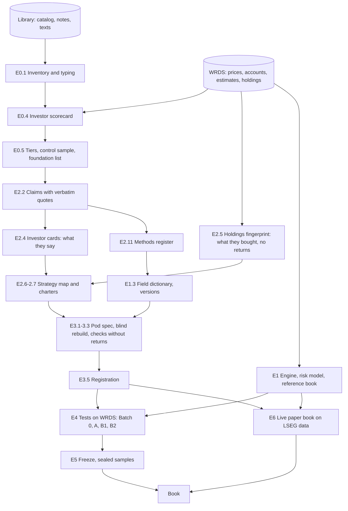

# Equity pod shop: evaluation of the workflow idea, and plan v0.3 (2026-11-15)

Status: design only. Nothing here is built, pulled or run. Written in the screener chat (Claude, Fable 5.2) at the
user's request for an independent evaluation of the idea and a plan of our own. Checked by a separate Opus agent
(section 13). `EQUITY_POD_SHOP_DESIGN_v0.2.md` stays in force as the detailed annex for everything this plan does
not change: its rules (section 3), portfolio and risk design (9), test sheet (10), live cycle (11) and terms (20).
Section 11 lists every amendment. Numbers marked "proposal" are fixed at registration, before any run.
Inventory numbers come from `library_inventory_2026-11-15.md` (script `tools/equity/library_stats.py`).

## 1. Verdict

The idea works as a pipeline and is worth building. Three corrections decide whether its results can be trusted.

1. **Ranking investors on their last five years tells us what to read first. It cannot tell us what is true.**
   Five years is mostly luck and style, the last five favoured one style (large US growth stocks), and the people
   in the library are already the ones who did well enough to be interviewed. So the ranking is widened (several windows,
   style taken out, every 13F filer as the yardstick, not only the famous ones), a random control group goes
   through the same pipeline, and the US years used for the ranking never count as proof for a strategy.
2. **"Backtest the pods and see which did well" finds a winner even when nothing works.** With no true edge, the
   best of 20 strategies still shows a Sharpe ratio near 0.5 over 15 years (a 15-year Sharpe ratio has a standard
   error of about 0.26, and the largest of 20 draws averages about 1.9 standard errors). So the number of tests is
   fixed in advance, every pod is measured with the same sheet against a reference book of known factors, and the
   ranking that counts is on data that played no part in the design. Our own WRDS run shows why: the three triage
   screens separated winners from losers, and all of it was the profitability factor
   (`docs/research/triage_wrds/RESULTS.md`).
3. **"Look at what they actually bought" is the strongest new element.** It makes the investors' words checkable
   (do they buy what they describe?) and measurable (what did a purchase look like on the day?). One fence: rule
   writers see what the purchases looked like at the time, never what the stocks did afterwards. What they did
   afterwards is the investor's record, and the ranking has already used it.

The statistical design of v0.2 holds. This plan adds what the new facts require: a front end for 2,257 documents,
an investor scorecard, a holdings module, a foundation track for technique transcripts, and a split of the holdout
by region. It also puts the cheap, script-only steps first.

What to expect, honestly: most rule layers of long-only investors will turn out to be known factors (value,
quality, momentum). The likely products are a tested reference book, exclusion rules that avoid large losers, a
small number of pods that add something, and a live record for the judgement no rule captures.

## 2. What changed since v0.2

| Fact | Detail | Consequence |
|---|---|---|
| The library is about six times larger | `G:\My Drive\Transcripts\Processed Transcripts`: 2,257 documents, 17.0M words. Each has the full text with line anchors, a short note with machine-checked quotes and a catalog entry; one search index covers all text | The inventory is almost free: it reads the catalog and notes, not the texts. Reading everything in depth is neither affordable nor needed |
| General Transcripts | 695 documents, 8.3M words (60 of them in a `macro nov 26` subfolder). By the catalog's speaker fields (heuristic): 327 have an investor present, 153 are a host discussing a book or a case, 123 are company executives, 92 authors, academics and others | Only a document with the investor present can establish what that investor said (rule 2 of v0.2). Book episodes are secondary sources |
| Investors | About 240 distinct investors; about 190 appear once, 48 twice or more. The 40 most frequent cover 146 documents (2.0M words) | Evidence per investor is thin. The unit of testing stays the family: several investors, one mechanism |
| Dates | 647 of the 695 are dated 2022-26 | Almost every thesis is stated after the holdout period began, by people chosen for doing well in it (section 8.2) |
| Technique content | Tags of about 440 General documents mention valuation, analysis, screening, portfolio construction, risk or shorting (overlapping counts) | Foundation track (section 7) |
| Other folders | Healthcare 431 (biotech desk design), AI CEO Interviews 883 (company evidence for the analyst layer, later), Macro 214, Banking 24, Media 10 | Out of scope here |
| LSEG Workspace | Runs in Excel on the user's own PC, any day. The macro probes already returned dated company history (Apple month-end prices from 1990) | Live source and second source (section 9) |
| Bloomberg | Campus only; the download allowance ran out on 13 Nov | No role in the design; optional cross-check sample |
| WRDS | Subscription also holds CRSP mutual funds, mutual fund holdings, Compustat Global, Financial Ratios, and the Global Factor Data (per the WRDS guide; permissions to be checked) | Real fund returns for the scorecard; non-US history for the region split |

## 3. The ideas, one by one

| Idea | What is right | What goes wrong if done plainly | What the plan does |
|---|---|---|---|
| Rank investors by five-year return; read the top 30-40 first | A triage is needed, and data beats reputation | Five years cannot separate skill from luck: a true edge of 3% a year against a typical 10-15% a year of deviation from the market gives a t-value near 0.5. A raw ranking for 2021-25 is a style ranking. Pods built from the winners look good in the years that made them winners. Many speakers have no measurable record | Scorecard (section 5): several windows, style taken out, all filers as yardstick, a grade for how well the record can be measured, a cap per style, a control sample, the ranking years kept out of the proof |
| Technique transcripts as a foundation | Definitions, valuation, sizing and risk practice are knowledge for the whole shop, not pods | Treating a technique as tested truth, or testing each one for returns (a second, untracked stream of trials) | Foundation track (section 7): each technique becomes a measure definition, a version, a check or an analyst question, or is dropped |
| One agentic pipeline from transcript to backtest | Most of the machinery exists (macro pipeline, WRDS runner, triage engine, forecast ledger) | Agents grading their own work; the model's knowledge of market history leaking into rules; licensed data leaving WRDS or the PC | Stations with a fixed input, output and gate (section 4); six fences (section 8.3) |
| Judge a strategy by the stocks its investors bought | Say-do check and measurable criteria | Using the later returns of those stocks as evidence for our rule. 13F shows US-listed long positions only, quarterly, 45 days late | Holdings module (section 6) |
| Find the pods with consistently high risk-adjusted returns | It is the goal | Best-of-many selection; "return" before known factors and costs are taken out; one era carrying the result | One yardstick (section 8) |
| WRDS, LSEG, Bloomberg | Each has a natural role | Mixing vendors inside one backtest; assuming LSEG history is as first reported; building on a source that cannot be refreshed | History on WRDS, live on LSEG, nothing on Bloomberg (section 9) |
| v0.2 as a suggestion | Its statistics, three layers, reference book and risk charter | It assumed 397 documents and no ranking; the holdings check was only pass or fail; its holdout rule leaves almost every family without a verdict from recent years | Kept as annex; amended in section 11 |

## 4. The workflow

| Step | Who | Output | Gate |
|---|---|---|---|
| E0.1 Inventory and typing (widened) | script reads the catalog; Sonnet reads the notes only; Opus recodes a tenth blind | One row per document: speakers and the role of each, kind (investor's own words, secondary, company, technique, macro), style tags, how explicit the criteria are | Agreement between the two coders per field; a field with low agreement is dropped |
| E0.2 Audit of the existing screens and criteria workbook | Opus | One page; each existing screen becomes a candidate family, unverified until tied to quotes | as v0.2 |
| E0.3 Equity paper pack | Sonnet; Opus blind read | Claims with quotes | as v0.2 |
| E0.4 Investor table and scorecard (new) | Sonnet matches speakers to firms and filer ids, Opus checks a sample; script on WRDS | One row per investor: firm, filer id or fund, record grade, record columns (section 5) | Output form fixed first; code passes a planted-error test |
| E0.5 Tiers (new) | script, rule registered before the scorecard is run | Tier A, control sample, tier B, foundation list, reading order | User go |
| E1 Data, engine, risk model, reference book | Opus; WRDS and PC runners | as v0.2 E1.1-E1.8 | Gates G1-G9 of v0.2 |
| E2.1 Pilot | Sonnet; Opus blind read | 16 documents: two per style for six styles, four technique documents. Cost per document, share of criteria a script can compute, whether investors say why the opportunity exists | Decides the size of E2.2 |
| E2.2 Claims | Sonnet extracts; script checks every quote against the text; Opus second read of a fifth | Claim ledger: quote, line, speaker, claim type, rule as stated, data needed | Every quote found in the text; agreement rate on record |
| E2.4 Investor cards | Sonnet; Opus recodes a fifth blind | Fingerprint card per investor (v0.2 7.3), every field with claim ids | Field agreement |
| E2.5 Holdings fingerprint (widened) | script on WRDS | Per investor: what purchases looked like on the day against sector peers; say-do table (section 6) | Aggregates only; nothing after the purchase date |
| E2.6-E2.9 Map, charters, playbook cards, thesis register | script clusters; Fable judges; Opus checks against the quotes | as v0.2 | No return data in any pack |
| E2.11 Methods register (new) | Opus drafts from technique claims; Fable reviews once | One row per technique and its use (section 7) | Every row cites claim ids |
| E3 Specs, checks, registration | Opus; fresh Opus rebuilds blind; scripts | as v0.2 | as v0.2; user go at E3.5 |
| E4 Tests | scripts on WRDS Cloud; verdict by script | Result sheets, verdict class | v0.2 section 10 |
| E5 Freeze and sealed samples | script; Fable verdict; Opus checks the numbers | One run per sealed sample | One-time key |
| E6 Live paper book | PC runner on LSEG data; Opus analysts; Sonnet report | Weekly lists, risk report, ledger, forecasts | Starts for the reference book once Batch 0 passes |

How the agents are run: a chat session orchestrates and does none of the judged work itself. Every job has a brief
from a template in the repo, an input pack built by a script, an output form checked by a script, a private work
folder, and a line in the usage log. Extraction runs as parallel Sonnet agents. Fable runs one unit a day with its
exact input stored. WRDS jobs go through `tools/wrdsq`, PC jobs through `tools/bbgq`; both return reports only.
Ledgers, cards, registers and packs live on a branch (`equity-vault`) and in the Obsidian vault; registration and
results in `docs/research/equity/`. The user releases each stage.

Each registered pod is also a live screen, like the current screeners: a weekly long list and short list with the
criteria behind every name.

## 5. Investor scorecard and reading order

### 5.1 How well a record can be measured (grade per investor)
| Grade | Meaning | Examples in the library (to be confirmed at E0.4) |
|---|---|---|
| A | Long-only stock picker whose 13F shows most of the book: a copy of the filing is close to the real portfolio | Giverny (Rochon), Valley Forge (Kantesaria), Semper Augustus (Bloomstran) |
| B | Partly visible: long/short funds (shorts unseen), global books, large private holdings | Greenlight (Einhorn), D1 (Sundheim), TCI (Hohn) |
| C | A 13F exists but says little: credit, macro, multi-manager platforms, books of hundreds of names | Oaktree (Marks), Balyasny, Gotham (Greenblatt), GMO (Grantham) |
| F | A public fund or listed vehicle with real returns after fees | Oakmark (Nygren), Acquirers Fund (Carlisle), Markel (Gayner) |
| N | No measurable record: authors, analysts, newsletter writers, most hosts | |

### 5.2 What is computed (one script, for every filer in the 13F data, not only ours)
- The copy portfolio: holdings as filed, bought the day after the 45-day deadline and held to the next filing,
  weighted as filed. Also the ten largest positions only, and new positions only.
- Windows: 2021-25 (the five years asked for), 2016-20, 2011-15, 2006-10, and the full history.
- Columns: return; return minus the market; return minus each holding's peer group of similar size, value and
  momentum (stock picking with style taken out); five-factor plus momentum alpha with its t-value; worst fall; share
  of years ahead of peers; number of positions; turnover; weight of the ten largest.
- Each column also as a percentile among all filers with 10-150 positions and at least $100M (proposal).
- Grade F: real returns after fees for the same windows (CRSP mutual funds and listed vehicles on WRDS; other
  funds through LSEG if the probe allows).
- What comes back: statistics per manager. No holdings, no return series.

### 5.3 Tier rule (proposal; committed before the scorecard is run)
- **Tier A, 40 investors, read in depth.** 30 by record: the average of three ranks (style-adjusted result over the
  full history, with at least eight years; the same for 2021-25; share of five-year blocks with a positive
  style-adjusted result), grades A, B or F, at most eight per style. Plus up to 10 whose documents are the most
  explicit about criteria, whatever their grade: this keeps investors whose record cannot be measured, and styles
  that had a bad decade.
- **Control, 10 investors.** Drawn at random by a seeded script from grades A, B and F outside tier A. Same
  pipeline. No agent is told who is control.
- **Tier B.** Everyone else stays in the inventory with style tags and can be promoted in a later round.
- **Foundation list.** The 40-60 documents (proposal) with the most technique content, whoever speaks.
- Reading order inside tier A: the investor's own words before secondary sources, more explicit documents first.

### 5.4 Fences
- The ranking orders the reading. It gives no weight to a claim, a family or a verdict.
- Extractors, coders and the strategist never see the scorecard or the tier labels.
- The thesis register logs the windows that selected each family's investors. Those US years are never proof for
  that family (section 8.2).
- The scorecard reads returns inside the sealed years. It is a registered descriptive job: its output form is
  committed first, the checker reads the code before it runs, and nothing per stock comes back.
- After the tests: do pods sourced from tier A do better on untouched data than pods sourced from the control
  group? Reported. If not, the ranking added nothing and is dropped for later rounds.

### 5.5 What the user sees first
The league table of the library's investors with the five-year column, where each sits among all filers, and the
top-ranked filers we hold no transcript for (candidates for letters or interviews to add).

## 6. Holdings module: what they bought, on the day they bought it

**Computed** per investor with holdings (13F filings; fund-level holdings for mutual funds), by a script on WRDS
with its output form fixed in advance. For each new position and each large addition: the stock's rank inside its
sector at that quarter-end on every measure in the field dictionary (valuation, profitability, growth, balance
sheet, past return, size, analyst revisions, distance from the 12-month high, short interest). Then the median and
spread across all purchases, the same for exits, the holding period, concentration, and how the profile moved over
time.

**Used for**
- A say-do table per investor: stated criterion (claim id), revealed median rank, and "agrees", "silent" or
  "contradicts". A contradiction goes back to the investor card, not into a spec.
- Thresholds. A criterion stated only as a direction ("high returns on capital") may take its threshold from the
  revealed distribution, for example the lower quartile of the family's purchases. The source is logged as
  "revealed", next to "quote", "convention" and "grid" (v0.2 8.1).
- The family test: investors of one family should buy similar profiles. If they do not, the family is split or
  the difference becomes a version.
- The spec check at E3.3: the pod's long list must contain the family's actual purchases at three times the
  universe rate or more (v0.2 8.3).

**Fences**
- No return after the purchase date appears in any output. A past return appears only as a rank on the day.
- Outputs are aggregates over at least 20 purchases per investor (proposal). No stock names leave WRDS here.
- It reads holdings and ranks inside the sealed years, so it is the second registered descriptive job, under the
  same terms as the scorecard.
- Every report states the limits: US-listed long positions, quarterly, 45 days late, no shorts, cash or non-US
  lines.

The same machinery gives one pod candidate that needs no transcript: follow the new positions of managers whose
record was good up to that date, ranked walk-forward. It competes for a test slot like any family.

## 7. Foundation track

**What goes in:** documents on valuation, analysis technique, accounting quality, screening, portfolio
construction, sizing, selling, risk management and shorting, whoever the speaker is, plus the equity paper pack.

**What comes out:** a methods register. One row per technique: what it is, who states it (claim ids), and its
single use in the shop.

| A technique that is | becomes |
|---|---|
| a way to define a measure (return on invested capital, owner earnings, cash flow after stock pay) | an entry in the field dictionary (E1.3). Where practitioners differ, each definition is a version, never a choice |
| a way to build or protect a portfolio (sizing, concentration, sell rules, stop-losses, hedges) | a version of the construction rule, a hygiene test in Batch A, or a line in the risk charter proposal |
| a way to value a company | part of the expectations link (v0.2 4.1) and the base-rate library (8.4) |
| a way to analyse a business (moat, management, accounting red flags) | a proxy in the proxy layer if a script can compute it; otherwise a question on the analyst sheet (v0.2 11.2), judged live |
| none of these | dropped, with the reason |

A technique is never tested for returns on its own and never adds a test slot.

## 8. One yardstick for every pod

### 8.1 The measurement (v0.2 sections 4, 9 and 10, unchanged)
- Same universe, same point-in-time rules, same costs and borrow fee for every pod.
- Criteria become scores ranked inside the sector. Gates only for eligibility and exclusions.
- One construction rule: long the top group and short the bottom group in each sector, equal money on both
  sides, no net market exposure, monthly tranches, a no-trade band.
- Five decisive tests: the pod adds to the reference book after all costs (corrected for the number of pods in the
  batch); it is not worse in any era; it survives doubled costs; it beats random portfolios of the same shape; it
  does not worsen the tail.
- Reported for every pod, not decisive: the pod on its own; the long side against sector peers (what a long-only
  holder would have earned); the short side; how fast the signal fades; what each criterion contributes; turnover;
  capacity; results by size and sector.
- Verdict by script: Core, Sleeve, Exclusion, Incubator or Shelved.
- Budget: Batch 0 (plumbing), Batch A (hygiene on the reference book), B1 and B2 (at most four pods each). A failed
  pod is not re-run with tweaks.
- A league table of every tested pod is published, labelled descriptive, with the number of trials behind it.

### 8.2 Samples, with one amendment
| Sample | Use |
|---|---|
| Design era: US, 1975-2010 | Building and design tests |
| Untouched regions: developed markets outside the US, 1990-2010 | Sealed; one run after the freeze |
| Holdout, US, 2011 onward | Sealed; one run. A verdict only for a family whose thesis is documented before 2011 and whose investors were not picked on those years. For every other family: reported, not a verdict |
| Holdout, outside the US, 2011 onward | Sealed; one run. Counts toward the verdict of every family: US-based investors were not chosen on these markets. It is weaker than a true holdout because styles move together across regions, so a family must pass both non-US samples |
| Live | Reference book from Stage 1; each pod from registration |

Tier A is picked on returns after 2010, so for nearly every investor family the US holdout will be reported only.
Their proof from recent years rests on the non-US holdout and the live record. Two consequences: non-US data is
part of the engine from Stage 1, and tier A must be complete before the freeze, because a family found later can
only be an Incubator pod.

### 8.3 Six fences
1. **Selection.** The ranking orders reading only; the control sample measures whether it helped.
2. **Returns.** No agent that writes claims, cards, charters or specs sees a return, of a stock or of an investor.
3. **Hindsight.** No company name, date or event in a rule. Every threshold traces to a quote, a convention, the
   grid or the revealed distribution. A fresh agent rebuilds each spec blind.
4. **Trials.** Slots fixed and registered before any run; one sheet; correction for the number of pods; no re-runs.
5. **Samples.** A sample counts as proof only if it could not have shaped the pod's sources (8.2).
6. **Checkers.** No step grades itself; checkers are tested with planted errors.

## 9. Data plan

| Need | History for backtests | Live | Notes |
|---|---|---|---|
| Prices, returns, delistings | CRSP on WRDS (to 2025-12, yearly update) | LSEG on the PC | Free fallback: Massive |
| Accounts as known on the day | Compustat on WRDS with report dates | LSEG fundamentals with source dates | Free fallback for the US: SEC filings, 2009 onward |
| Analyst estimates | I/B/E/S on WRDS | LSEG (I/B/E/S) | |
| Holdings | 13F and mutual fund holdings on WRDS; SEC 13F data sets from 2013 | SEC 13F (free); LSEG ownership | The WRDS 13F file is compared with the SEC's own at E1.2 |
| Insider trades | SEC Form 4 data sets (free; `triage/owners.py` reads them) | same | WRDS insider table: no permission |
| Short interest | Compustat on WRDS (to be checked) | LSEG (to be probed) | |
| Markets outside the US | Compustat Global and Global Factor Data on WRDS (to be checked) | LSEG, Datastream | |
| Fund returns for the scorecard | CRSP mutual funds, listed vehicles in CRSP | LSEG fund data (to be probed) | |
| Factor returns | Fama-French and Global Factor Data on WRDS | Ken French's site | |

**LSEG Workspace: what is established**
- On the user's PC the Excel functions work: company data with dated history (`RDP.Data`, the older `TR`), and
  Datastream (`DSGRID`). Source: `tools/bbgq/results/lseg_probe_v1.txt`.
- LSEG's fact sheet: more than 108,000 active and inactive companies; US history from 1983, other countries from
  the 1990s; values as reported, standardised and restated; "point-in-time details on the source publication";
  700+ industry operating metrics.
- Fields carry the period end, the source filing date and whether a value is original or restated
  (`TR.F.SourceDate`, `.FundUpdType`, `.periodenddate`). Holders of a stock can be listed as of a past date
  (`TR.InvestorFullName`, `TR.PctOfSharesOutHeld` with a date); the summary ownership field has no history.
  Source: LSEG developer community.
- Limits of the Python interface: about 5 requests a second, 50 MB a minute, 3,000 rows per history request, and
  a daily cap that resets at local midnight. Excel has its own limits.

**What only a probe on the user's PC can settle (E1.1; one workbook of about 150 formulas, one refresh)**
- A universe that includes dead companies; identifiers to join with WRDS.
- First-reported values in bulk, with dates, for companies known to have restated.
- Analyst consensus as it stood on past dates, and how far back.
- Holders by quarter and how far back; insider trades; short interest.
- Datastream: accounts, lists of dead stocks, past index members.
- Fund returns; StarMine scores; the size of request Excel accepts; whether the licence covers the Python
  interface (if so, pulls run as scripts on the PC runner, without Excel).

**Roles.** History stays on WRDS unless the probe shows first-reported values and dead companies on LSEG. LSEG is
the live source, the second source for the two-source gate (G7), and the source for what WRDS lacks. Bloomberg has
no role: no input of any pod may exist only there. The 4,512-stock workbook stays as an optional one-off
cross-check.

**Licences.** WRDS is licensed for academic research and paper trading, and its data may not be loaded into AI
tools: jobs run on WRDS Cloud and only statistics return. LSEG data stays on the PC under the same practice. Before
any real money, the live path must run on data whose licence allows it (step E5.5); the free SEC and price route in
the repo is kept working for that reason.

## 10. Stages and effort

| Stage | Content | Output for the user |
|---|---|---|
| 0. Know the library and the data | E0.1 inventory; E0.4 scorecard; E0.5 tiers; E1.1 LSEG probe (one refresh by the user); E1.2 WRDS table check | Investor league table; tier lists and reading order; what LSEG and WRDS return under these licences |
| 1. Measurement engine and pilot | E1.3-E1.6; Batch 0; reference book live on paper; E2.1 pilot | A working reference book with its weekly risk report; measured cost and yield per transcript |
| 2. Library | E2.2-E2.11 for tier A, control and foundation; E0.2; E0.3; E1.7-E1.8 | Claim ledger, investor cards, holdings fingerprints, strategy map, charters, methods register |
| 3. Specs, registration, tests | E3; Batch A; B1; B2 | Verdict per pod; each pod's live screen from registration |
| 4. Freeze, sealed samples, book | E5 | Final verdicts; the book |

Effort, in tokens. The figures for Fable and the engine come from the macro program's log; the extraction figure
is a guess that the pilot replaces with a measurement.
- Stage 0: typing about 700 notes, about 1.5M (Sonnet); scorecard and probe builds, under 1M (Opus).
- Extraction: perhaps 50-60k per document for both reads. Tier A, control and foundation, 200-250 documents:
  10-15M (Sonnet, with Opus on a fifth).
- Fable: one map, 6-12 charters, one register review, two batch reviews, one verdict: 11-17 units of 0.65-0.9M,
  each with an Opus check of about 0.3M.
- Engine, risk model, specs and checks: 5-8M (Opus).

One Fable unit a day stays the rule.

## 11. Amendments to v0.2

| v0.2 | Amendment |
|---|---|
| 4.2 Samples | The holdout is split by region. For a family with career overlap or picked through the scorecard, the US part is reported only; the non-US part counts, and both non-US samples must pass (8.2 above) |
| 6.1 Sources | The library is `Processed Transcripts`. Bloomberg has no role. Insider trades come from the SEC data sets. CRSP mutual funds and mutual fund holdings join the list |
| 7.1 Pilot | 16 documents: twelve investor documents (two per style) and four technique documents. The inventory questions are answered from the catalog first |
| 7.2 Claim types | Add "technique" (a definition or method) for the methods register. Every claim carries its source class: the investor's own words, or secondary |
| 7.4 Families | "Investor" means a person who ran money (grades A, B, C or F), not an author or host. Secondary sources count as at most one published source per family |
| 8.1 Spec | A threshold may also come from the revealed distribution (section 6) |
| 8.3 Say-do | Uses ranks on the day, price-based ones included, inside the registered descriptive job. This replaces "accounting measures only" for quarters after 2010 |
| 8.5 Slots | Pods sourced from the control sample run in B2 for Incubator status only. The walk-forward "follow the best managers" pod is a candidate |
| 13 Steps | New: E0.4, E0.5, E2.11. Widened: E0.1, E2.5 |
| 14 Order | Stage 0 precedes Stage 1 |
| 16 Reuse | Add the processed library (texts with line anchors, checked quotes, search index) and `tools/wrdsq/tri_wrds_adapter.py` (CRSP, Compustat and 13F panel with resumable pulls) |
| E5.5 Execution | Add the licence check before real money (section 9) |

## 12. What can go wrong

| Risk | Answer |
|---|---|
| Most investors appear once, so families are thin | Families need three money-running investors; the inventory's style tags show the whole population; thin groups become single-investor playbooks (Incubator) |
| A 13F copy misleads (grades B and C) | Grades; real fund returns where they exist; every scorecard row states what it cannot see |
| Non-US data is weaker, or not permitted | Checked at E1.2 before anything depends on it. If it fails, proof from recent years rests on the live record alone, and the plan says so |
| LSEG history is restated or drops dead companies | History stays on WRDS; our own archive starts with the first live week |
| Everything turns out to be a known factor | Then the reference book, the exclusion rules and the live analyst record are the product |
| Token cost | Tiers; pilot before scale; the cheap steps first |
| University licences end | Free US route kept working; archive kept |

## 13. Independent check

PENDING.

## 14. Needed from the user (facts, not design choices)
1. A go for Stage 0.
2. One refresh of the LSEG probe workbook at home, once it is built.
3. Whether the LSEG licence covers the Python interface, if known (the probe also tests it).
4. How long WRDS and LSEG access will last.

## 15. Sources

Repo: `EQUITY_POD_SHOP_DESIGN_v0.2.md`; `library_inventory_2026-11-15.md`; `docs/research/triage_wrds/RESULTS.md`;
`tools/bbgq/results/lseg_probe_v1.txt`; `tools/wrdsq/GUIDE_FOR_NEW_CHATS.md` (WRDS subscription and licence).

Web, read 2026-11-15:
- LSEG, "The Data Library for Python: maximum usage reference guide":
  https://developers.lseg.com/en/article-catalog/article/the-data-library-for-python-maximum-usage-reference-guide
- LSEG Company Fundamentals fact sheet:
  https://www.lseg.com/content/dam/data-analytics/en_us/documents/fact-sheets/lseg-company-fundamentals-fact-sheet.pdf
- LSEG developer community, original and restated flags on fundamentals:
  https://community.developers.lseg.com/discussion/132467/company-fundamental-fundupdtype-sometimes-returns-nat-sometimes-value-ie-original-restated
- LSEG developer community, ownership over time:
  https://community.developers.lseg.com/discussion/44105/instituitional-ownership-over-time
- LSEG Data Library, estimates content:
  https://cdn.refinitiv.com/public/lseg-lib-python-doc/2.0.0.2/book/en/sections/content-layer/estimates/about-estimates.html

From the writer's knowledge, to be verified when the papers enter the pack: Carhart (1997) on the weak persistence
of fund performance; Cohen, Polk and Silli on managers' best ideas; Daniel, Grinblatt, Titman and Wermers (1997) on
peer groups by size, value and momentum; Harvey, Liu and Zhu (2016) and Bailey and Lopez de Prado (2014) on
selection among many backtests.
